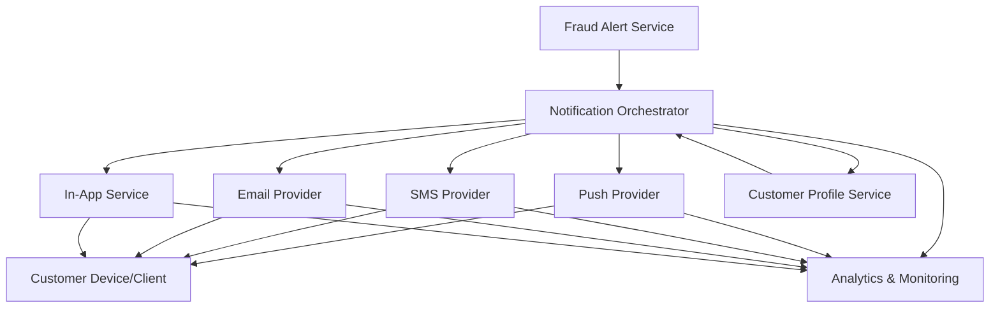

#### 1. High-Level Design

- **Summary:** This epic delivers the customer-facing fraud alert notification system, enabling multi-channel delivery (push, SMS, email, in-app) of concise, actionable fraud alerts. It provides customers with transaction context (amount, merchant, time, location, card details) and ensures timely, accessible communication while respecting preferences and implementing fallback mechanisms for channel failures.

- **Component Flow:**

- **Integration Points:**
  - **Upstream:** Fraud Alert Service (from Epic QE-7362) provides canonical alert records
  - **Downstream:** Notification providers (push, SMS, email services), Customer Profile Service for preferences, Customer Identity/Authentication Service for secure alert access
  - **Supporting:** Analytics infrastructure for tracking delivery metrics (fraud_alert_sent, fraud_alert_delivered, fraud_alert_viewed, fraud_alert_failed)

- **Key Assumptions:**
  - Customer notification preferences are stored in a centralized Customer Profile Service with real-time accessibility
  - Notification provider APIs support synchronous delivery confirmation or webhook callbacks for delivery status tracking

- **NFR Highlights:** Near-real-time alert delivery latency SLA from transaction event to notification delivery; high availability for notification services with disaster recovery; secure handling with encryption in transit and at rest; privacy controls to minimize sensitive data exposure (no full card numbers); robust observability of delivery status by channel and provider

- **Data Flow:**
  1. **Input:** Canonical fraud alert record from Fraud Alert Service containing alert_id, transaction details, customer_id, severity, and status
  2. **Processing:** Notification Orchestrator retrieves customer notification preferences from Customer Profile Service, selects primary channel (push/SMS/email/in-app), formats alert content with transaction context (masked card, amount, merchant, time, location, risk message, actions), attempts delivery via selected provider
  3. **Fallback:** On primary channel failure, orchestrator attempts approved fallback channel per security policy
  4. **Output:** Notification delivered to customer device/client with deep link to alert detail view; delivery status (queued/delivered/failed) recorded and emitted as analytics events; alert state transitions from 'queued' to 'delivered' or records failure reason

#### 2. Validation Report

- **Requirements Coverage:** The design addresses all core requirements including multi-channel delivery (FR-04), transaction context display (FR-05), notification preferences (FR-12), fallback behavior (FR-11), alert viewing capability (FR-13), and operational visibility (FR-14). The component flow supports alert state transitions (created → queued → delivered → viewed) and analytics event emission as specified in the PRD sections 11 and 16. Accessibility requirements across supported platforms are architecturally supported through the multi-channel approach.

---

