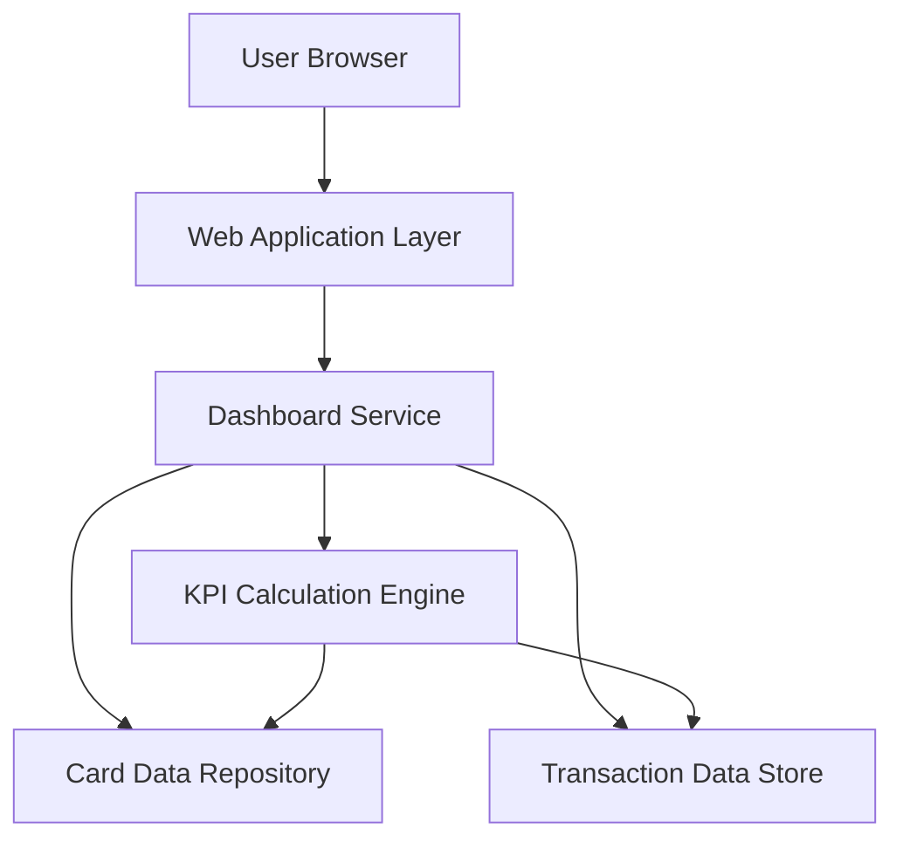

#### 1. High-Level Design

- **Summary**: This epic delivers a consolidated, responsive dashboard that aggregates and displays key financial metrics across multiple credit cards for a single user. The core requirement is to provide an at-a-glance view of monthly spend, total credit limit, available credit, and outstanding amount across all cards through a modern, responsive interface suitable for desktop, tablet, and mobile devices.

- **Component Flow**:

- **Integration Points**: 
  - Internal card data repository or mock data sources (no external banking systems)
  - Internal transaction data storage
  - No live connectivity to external banking networks or payment gateways

- **Key Assumptions**: 
  - Card and transaction data is pre-populated in internal repositories with sufficient detail for KPI calculations
  - Data refresh frequency is adequate for "low-latency" interactive use without requiring real-time bank feeds

- **NFR Highlights**: System must present dashboard KPIs with low-latency data retrieval suitable for interactive use; UI must be responsive across common device sizes (desktop, tablet, mobile)

- **Data Flow**: User requests dashboard → Web application authenticates and routes request → Dashboard service queries card repository and transaction store → KPI calculation engine aggregates data (monthly spend, total limits, available credit, outstanding amounts) → Calculated KPIs and card details returned to web layer → Responsive UI renders consolidated view in user's browser

#### 2. Validation Report

- **Requirements Coverage**: The design fully covers the epic's stated scope including dashboard layout, multi-card display, all four KPIs (monthly spend, total credit limit, available credit, outstanding amount), and responsive UI. The component architecture supports low-latency data retrieval through dedicated KPI calculation engine and separation of concerns between presentation, service, and data layers. The exclusion of real bank integration, payments, and transfers is respected by relying solely on internal data repositories.

---
