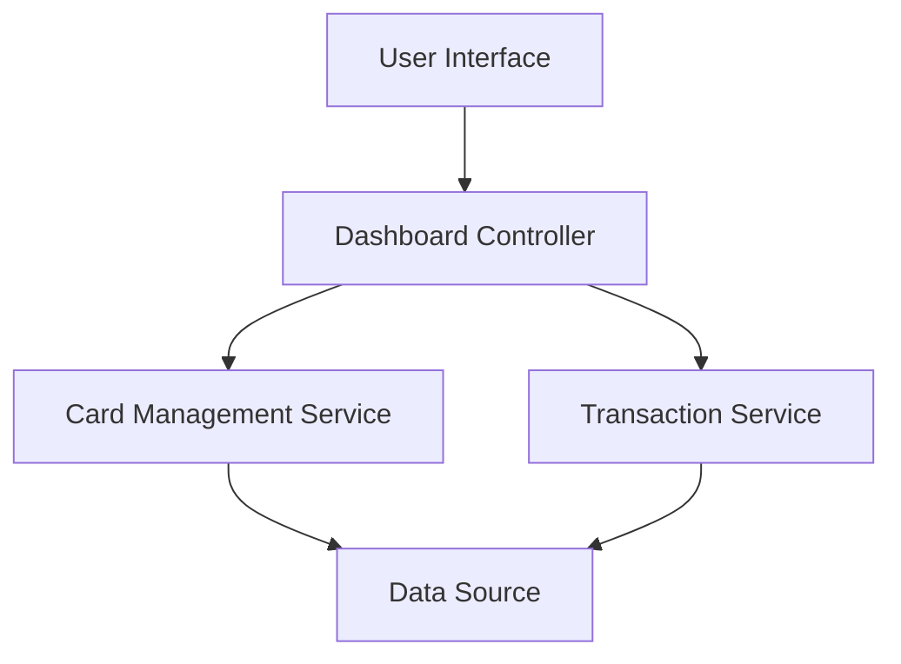

#### 1. High-Level Design

- **Summary**: This epic enables users to manage and review multiple credit cards and their associated transactions from a unified interface. Users can view card details (credit limit, available credit, outstanding amount) and transaction-level information (date, amount, category) in a consolidated view, eliminating the need to switch between separate systems.

- **Component Flow**:

- **Integration Points**: Internal or mocked transaction and card data sources; Shared dashboard components and layout from the core dashboard framework.

- **Key Assumptions**: Transaction data is pre-aggregated and available in a queryable format; Card data includes all necessary attributes (credit limit, available credit, outstanding amount) in a single data model.

- **NFR Highlights**: System should handle displaying data for multiple cards without performance degradation; Transaction list rendering should remain responsive for typical user volumes; Data views must respect security and privacy by not exposing sensitive card identifiers.

- **Data Flow**: User selects a card from the multi-card listing → Dashboard Controller fetches card details from Card Management Service and transaction history from Transaction Service → Both services query the Data Source (internal/mocked) → Aggregated card KPIs and transaction list are rendered in the UI → User can view transaction attributes (date, amount, category) aligned with card-level metrics.

#### 2. Validation Report

- **Requirements Coverage**: The design fully covers the epic's scope including multi-card listing/selection, card detail views, transaction list display, and basic transaction attributes. All specified NFRs (performance for multiple cards, responsive transaction rendering, security/privacy) are addressed through service-layer separation and UI optimization considerations.

---

