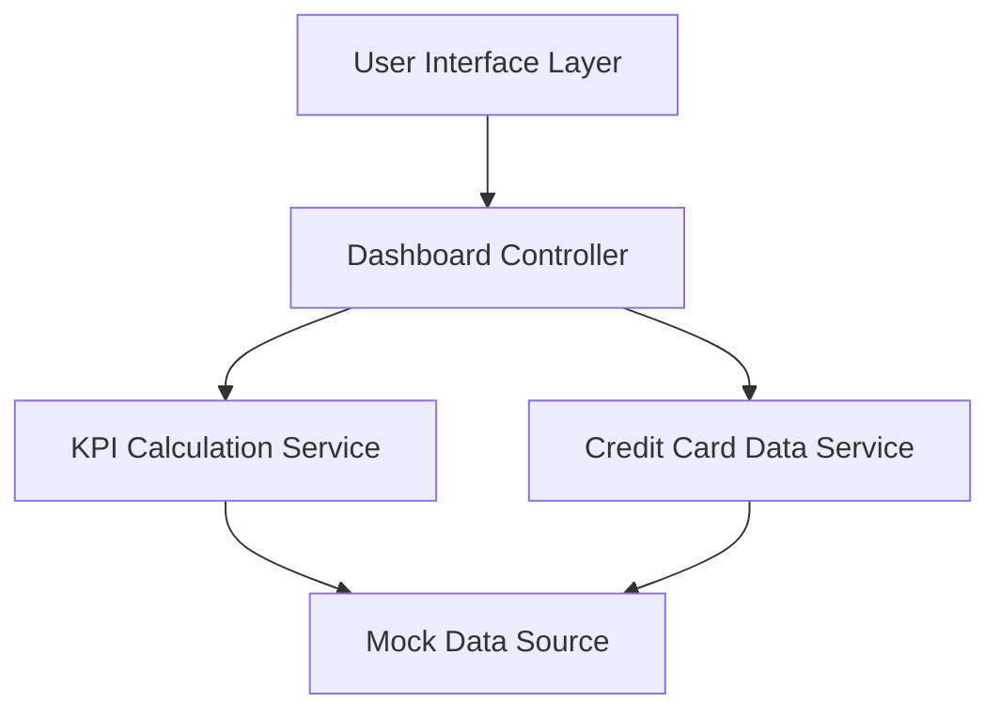

#### 1. High-Level Design

- **Summary:** This epic delivers a consolidated dashboard that displays key performance indicators (Monthly Spend, Total Credit Limit, Available Credit, Outstanding Amount) and provides a unified view of all user credit cards. It serves as the primary landing page for credit card financial health monitoring with a responsive, modern interface across all devices.

- **Component Flow:**

- **Integration Points:** 
  - **Upstream:** Mock credit card data service for card information
  - **Upstream:** Transaction data aggregation service for calculating KPIs (Monthly Spend, Outstanding Amount)
  - **Downstream:** Provides consolidated view that may be consumed by other modules

- **Key Assumptions:** 
  - KPI calculations will be performed server-side with periodic refresh intervals (not real-time streaming)
  - Credit card data structure includes standard fields: card number (masked), issuer, credit limit, current balance, available credit

- **NFR Highlights:** Dashboard must be responsive across all device types (mobile, tablet, desktop); page load time optimized for quick access; data accuracy and consistency across all views.

- **Data Flow:** User accesses the dashboard UI → Dashboard Controller fetches credit card details from Credit Card Data Service and requests KPI calculations from KPI Calculation Service → Both services retrieve data from Mock Data Source → KPI Calculation Service aggregates transaction data to compute Monthly Spend and Outstanding Amount → Credit Card Data Service retrieves card-level data (credit limits, balances) → Consolidated KPIs and card information are returned to Dashboard Controller → UI renders responsive dashboard with all KPIs and credit card overview.

#### 2. Validation Report

- **Requirements Coverage:** The design fully covers the epic's stated scope including Dashboard KPIs display (Monthly Spend, Total Credit Limit, Available Credit, Outstanding Amount), multiple credit cards view, consolidated credit card information, and responsive layout design. The component architecture supports all functional requirements and NFRs specified in the epic. The separation of concerns between UI, controller, calculation service, and data service ensures maintainability and scalability. All out-of-scope items (real bank integration, payments, fund transfers, loans) are appropriately excluded from the design.