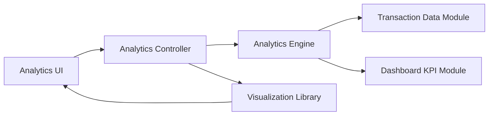

#### 1. High-Level Design

- **Summary:** This epic delivers interactive visualizations and analytical capabilities for understanding spending patterns across categories and time periods. It includes monthly spend trends, card-wise spend analysis, and category-wise spending breakdowns across nine predefined categories (Food & Dining, Fuel, Shopping, Travel, Entertainment, Utilities, Healthcare, Education, Miscellaneous) with interactive, responsive visualizations.

- **Component Flow:**

- **Integration Points:** 
  - **Upstream:** Transaction Management module for transaction data
  - **Upstream:** Dashboard KPIs module for aggregate spend metrics
  - **Downstream:** Charting/visualization library (e.g., Chart.js, D3.js, Recharts) for rendering interactive charts

- **Key Assumptions:** 
  - Category assignment is already performed in Transaction Management module; Analytics module consumes pre-categorized data
  - Monthly aggregations will be computed on-demand with caching for performance optimization

- **NFR Highlights:** Visualizations must render efficiently even with large transaction datasets; charts and graphs must be interactive and responsive; analytics calculations must be accurate and reflect real-time or near-real-time data.

- **Data Flow:** User navigates to Analytics section via UI → Analytics Controller requests analytical data from Analytics Engine → Analytics Engine retrieves transaction data from Transaction Data Module and aggregate metrics from Dashboard KPI Module → Engine performs calculations for monthly trends, card-wise analysis, and category-wise breakdowns across the nine predefined categories → Calculated analytics data is returned to Analytics Controller → Controller formats data for visualization and passes to Visualization Library → Library renders interactive, responsive charts (line charts for trends, bar charts for card-wise comparison, pie/donut charts for category breakdown) → User interacts with visualizations (filter by date, card, category) triggering new data requests through the same flow.

#### 2. Validation Report

- **Requirements Coverage:** The design fully addresses all requirements in the epic including monthly spend trends visualization, card-wise spend analysis, category-wise spending charts for all nine specified categories (Food & Dining, Fuel, Shopping, Travel, Entertainment, Utilities, Healthcare, Education, Miscellaneous), and interactive visualizations. The architecture separates concerns between analytics computation (Analytics Engine) and visualization rendering (Visualization Library), ensuring maintainability and flexibility. Integration dependencies with Transaction Management and Dashboard KPIs modules are clearly defined. All NFRs regarding efficient rendering, interactivity, responsiveness, and calculation accuracy are addressed through the component design. Out-of-scope items (real bank integration, predictive analytics, budget recommendations, spending limit alerts, custom category creation) are appropriately excluded.