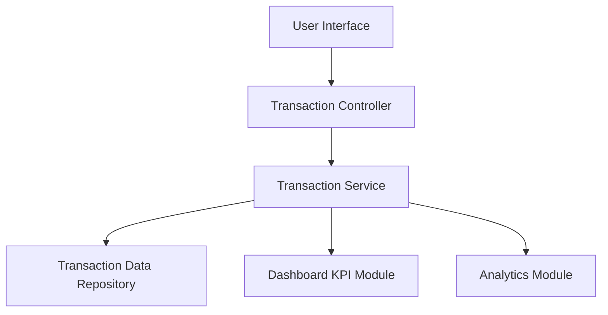

#### 1. High-Level Design

- **Summary:** This epic provides comprehensive transaction management capabilities allowing users to view, track, and analyze credit card transactions across all their cards. It includes transaction listing, detailed transaction views, multi-card transaction aggregation, and feeds transaction data to dashboard analytics and spending insights modules.

- **Component Flow:**

- **Integration Points:** 
  - **Upstream:** Mock transaction data service or transaction data source
  - **Downstream:** Integrates with Dashboard KPIs module for spend calculations
  - **Downstream:** Feeds data to Analytics module for category-wise analysis

- **Key Assumptions:** 
  - Transactions will be pre-categorized in the data source (categories assigned at ingestion)
  - Transaction history will support pagination for users with high transaction volumes

- **NFR Highlights:** System must handle transaction data efficiently for users with multiple cards and high transaction volumes; transaction data must be displayed accurately with proper categorization; interface must support easy navigation through transaction history.

- **Data Flow:** User requests transaction list via UI → Transaction Controller invokes Transaction Service → Transaction Service queries Transaction Data Repository with filters (card, date range, category) → Repository returns paginated transaction records → Transaction Service formats and enriches transaction data → Data is sent to Transaction Controller for UI rendering → Simultaneously, Transaction Service pushes aggregated transaction data to Dashboard KPI Module for spend calculations and to Analytics Module for category-wise analysis → UI displays transaction list with details (date, merchant, amount, category, card).

#### 2. Validation Report

- **Requirements Coverage:** The design comprehensively addresses all requirements specified in the epic including transaction listing and display, transaction details view, multi-card transaction aggregation, and transaction data feed for analytics. The architecture supports efficient handling of high transaction volumes through pagination and proper data access patterns. Integration points with Dashboard KPIs and Analytics modules are clearly defined. The design excludes all out-of-scope items (real bank integration, payments, fund transfers, real-time alerts) as specified. NFRs around efficiency, accuracy, and navigation are addressed through the layered architecture and data repository pattern.