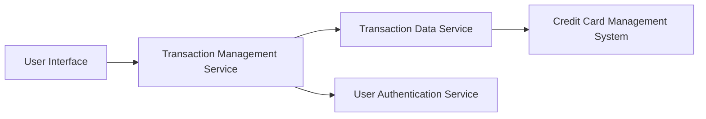

#### 1. High-Level Design

- **Summary:** This epic enables comprehensive transaction management capabilities, allowing users to view, search, filter, and track credit card transactions across all their cards. It provides detailed transaction histories with search and filter functionality, supporting up to 10,000 transactions per user with at least 12 months of data retention.

- **Component Flow:**

- **Integration Points:**
  - **Upstream:** User authentication service (for user identity verification and access control)
  - **Downstream:** Transaction data service (for retrieving transaction records), Credit card management system (for linking transactions to specific cards)

- **Key Assumptions:**
  - Transactions are stored with standardized attributes including date, amount, merchant, category, and card identifier.
  - Search and filter operations are supported by indexed database queries for performance optimization.

- **NFR Highlights:** Support up to 10,000 transactions per user, transaction query response time under 500ms, and data retention for at least 12 months of transaction history.

#### 2. Validation Report

- **Requirements Coverage:** The design addresses all scope elements including transaction listing, details view, multi-card support, search and filter capabilities, history display, and responsive interface. The architecture integrates with all specified dependencies (transaction data service, credit card management system, user authentication) and meets the defined NFRs for volume, performance, and data retention.