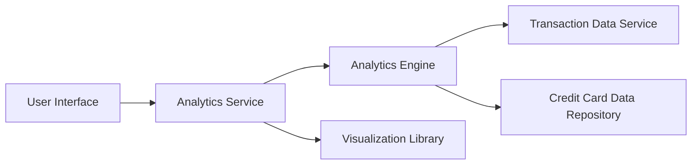

#### 1. High-Level Design

- **Summary:** This epic delivers interactive analytics and visualization capabilities that enable users to understand spending patterns through category-wise analysis and monthly trend visualization. It supports 9 predefined spending categories and provides card-wise spend analysis with historical data analysis for up to 24 months.

- **Component Flow:**

- **Integration Points:**
  - **Upstream:** Transaction data service (for retrieving transaction records for analysis), Credit card data repository (for card-specific spending data)
  - **Downstream:** Analytics engine (for processing and aggregating spending data), Visualization library (for rendering charts and graphs)

- **Key Assumptions:**
  - Transactions are pre-categorized or categorized on-the-fly using a category mapping service into the 9 predefined categories.
  - Monthly trend calculations are performed using aggregated transaction data grouped by month and category.

- **NFR Highlights:** Analytics calculations must complete within 3 seconds, support 9 predefined spending categories, handle historical data analysis for up to 24 months, and visualization rendering must be optimized for performance.

#### 2. Validation Report

- **Requirements Coverage:** The design covers all scope elements including category-wise spending visualization, monthly spend trends, card-wise spend analysis, interactive charts and graphs, spending pattern identification, multi-category support, and responsive analytics interface. The architecture integrates with all specified dependencies (analytics engine, transaction data service, visualization library, credit card data repository) and adheres to the defined NFRs for performance, category support, and historical data handling.