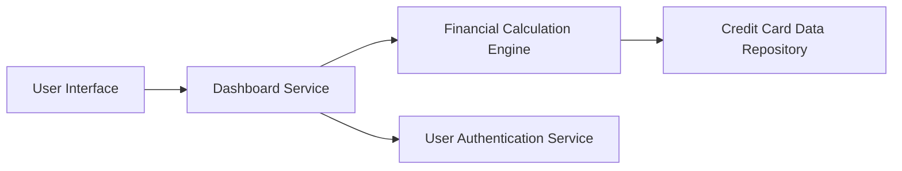

#### 1. High-Level Design

- **Summary:** This epic delivers a consolidated dashboard that displays key performance indicators (KPIs) for credit card management. The dashboard aggregates and presents monthly spend, total credit limit, available credit, and outstanding amounts across all user credit cards in a single, responsive interface with real-time financial metrics.

- **Component Flow:**

- **Integration Points:**
  - **Upstream:** User authentication service (for user identity and access control)
  - **Downstream:** Credit card data repository (for retrieving card details and balances), Financial calculation engine (for aggregating and computing KPIs)

- **Key Assumptions:**
  - Credit card data is available in a structured format with fields for credit limit, current balance, and transaction totals.
  - Real-time data refresh is achieved through periodic polling or event-driven updates from the data repository.

- **NFR Highlights:** Dashboard must load within 2 seconds, support responsive design for mobile and desktop, handle up to 20 credit cards per user, and provide real-time data refresh capability.

#### 2. Validation Report

- **Requirements Coverage:** The design covers all stated scope elements including dashboard KPI display, monthly spend tracking, credit limit aggregation, available credit calculation, outstanding amount display, multi-card view, and responsive UI. The architecture integrates with all specified dependencies (authentication service, data repository, calculation engine) and respects the defined NFRs for performance and scalability.