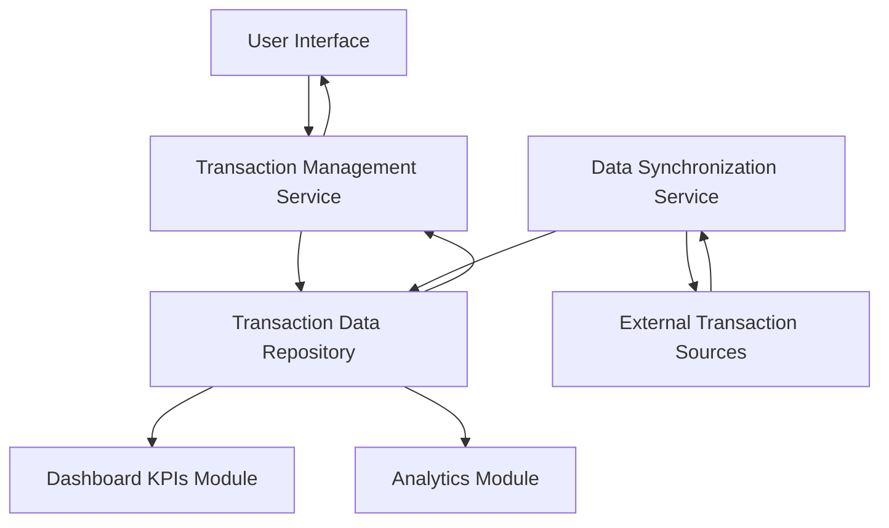

#### 1. High-Level Design

- **Summary:** This epic enables users to view and manage their credit card transactions within the dashboard, providing detailed transaction information that serves as the foundational data layer for KPI displays and analytics. The feature ensures complete visibility into transaction history across all user credit cards with efficient handling of large transaction volumes.

- **Component Flow:**

- **Integration Points:**
  - **Upstream:** External transaction data sources (for retrieving transaction records)
  - **Internal:** Data synchronization services (to maintain transaction history consistency)
  - **Downstream:** Dashboard KPIs module (consumes transaction data for KPI calculations)
  - **Downstream:** Analytics module (consumes transaction data for spending analysis)

- **Key Assumptions:**
  - Transaction data synchronization occurs at regular intervals (batch or streaming, frequency not specified)
  - Transaction data includes standard fields (date, amount, merchant, category, card identifier) in consistent format

- **NFR Highlights:** System must handle and display large volumes of historical transactions efficiently; transaction data accuracy and consistency with source systems required; search and filter operations must perform within acceptable response times

- **Data Flow:** External Transaction Sources push/provide transaction data → Data Synchronization Service retrieves and normalizes transactions → Transaction Data Repository stores historical transaction records → User requests transaction list view → Transaction Management Service queries repository with filters/search criteria → Service returns paginated transaction results → UI displays transaction list with details (date, merchant, amount, category, card) → Transaction data feeds into Dashboard KPIs Module for spend calculations and Analytics Module for visualization → User can view transaction details, search, and filter across multiple cards

#### 2. Validation Report

- **Requirements Coverage:** The design fully addresses the epic's scope including transaction list view, transaction details display, multi-card transaction aggregation, and transaction data integration with dashboard KPIs and analytics. The architecture explicitly handles NFRs for efficient handling of large transaction volumes through repository pattern and pagination, ensures data accuracy and consistency via dedicated synchronization service, and supports performant search/filter operations. Integration dependencies with transaction data sources, synchronization services, and downstream modules (Dashboard KPIs and Analytics) are clearly defined. The design establishes the foundational data layer as intended, enabling the other epics to function effectively.