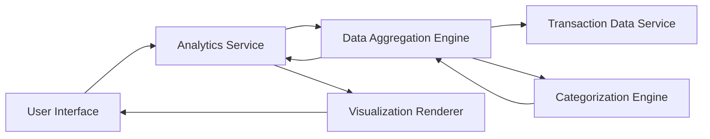

#### 1. High-Level Design

- **Summary:** This epic provides users with interactive visualizations and analytical insights into their credit card spending patterns. Users can analyze expenses across 9 predefined categories (Food & Dining, Fuel, Shopping, Travel, Entertainment, Utilities, Healthcare, Education, Miscellaneous), view monthly spend trends, and examine card-wise spend breakdowns to understand expenditure distribution.

- **Component Flow:**

- **Integration Points:**
  - **Upstream:** Transaction data service or repository (for retrieving transaction history)
  - **Internal:** Data aggregation and categorization engine (for spending analysis and category assignment)
  - **Internal:** Visualization renderer (for generating interactive charts and graphs)

- **Key Assumptions:**
  - Transactions are pre-categorized or categorization logic exists to map transactions to the 9 predefined categories
  - Historical transaction data is available for at least 12 months to support meaningful trend analysis

- **NFR Highlights:** Visualizations must render efficiently with large transaction datasets; interactive elements must respond within acceptable latency thresholds; charts must be responsive and accessible across different screen sizes

- **Data Flow:** User accesses analytics view → Analytics Service requests transaction data → Transaction Data Service retrieves historical transactions → Categorization Engine assigns transactions to predefined categories → Data Aggregation Engine calculates category-wise totals, monthly trends, and card-wise breakdowns → Aggregated analytics data returned to Analytics Service → Visualization Renderer generates interactive charts (bar charts, pie charts, line graphs) → UI displays spending patterns, trends, and distributions → User interacts with visualizations to drill down into specific categories or time periods

#### 2. Validation Report

- **Requirements Coverage:** The design comprehensively covers the epic's scope including category-wise spending analysis across 9 predefined categories, monthly spend trends visualization, card-wise spend analysis, interactive charts and graphs, and spending pattern identification. The architecture addresses NFRs for efficient rendering with large datasets, acceptable latency for interactive elements, and responsive chart display. Dependencies on transaction data service and categorization engine are explicitly integrated. The modular design separates concerns (data retrieval, categorization, aggregation, visualization) enabling maintainability and scalability.