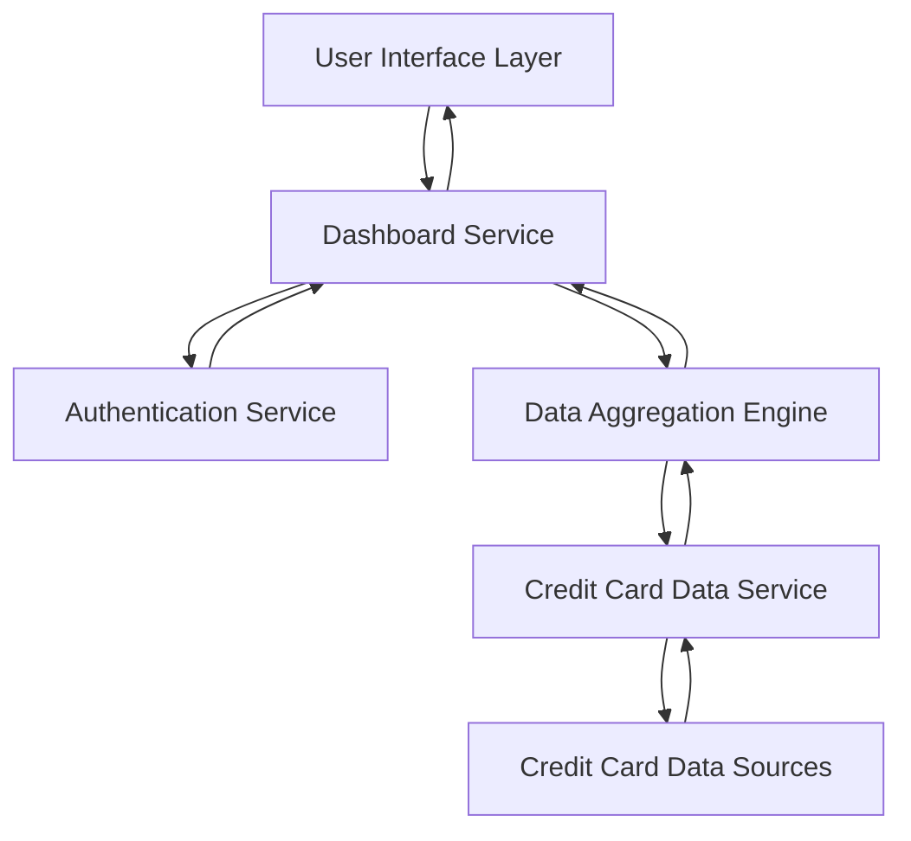

#### 1. High-Level Design

- **Summary:** This epic delivers a consolidated dashboard that provides users with a comprehensive view of their credit card portfolio, displaying key performance indicators including monthly spend, total credit limit, available credit, and outstanding amounts across multiple credit cards. The solution enables users to monitor their overall credit card financial health from a single, responsive interface.

- **Component Flow:**

- **Integration Points:** 
  - **Upstream:** Credit card data sources (for retrieving card details, balances, credit limits, and outstanding amounts)
  - **Upstream:** User authentication service (for secure access control)
  - **Internal:** Data aggregation engine (for calculating KPIs across multiple cards)

- **Key Assumptions:** 
  - Credit card data is available via API or data service with standardized format (JSON/REST assumed)
  - Data refresh frequency is near real-time (polling or event-driven updates, specific interval not defined in epic)

- **NFR Highlights:** Dashboard must be responsive across desktop, tablet, and mobile devices; optimized page load time for quick access; real-time or near real-time data accuracy and updates required

- **Data Flow:** User authenticates → Dashboard Service requests user's credit card data → Credit Card Data Service fetches data from external sources → Data Aggregation Engine calculates KPIs (total credit limit, available credit, outstanding amounts, monthly spend) → Aggregated KPIs returned to Dashboard Service → UI Layer renders responsive dashboard with multi-card view and KPI widgets → User views consolidated financial position

#### 2. Validation Report

- **Requirements Coverage:** The design fully covers the epic's stated scope including Dashboard KPIs display, multiple credit card view, monthly spend tracking, total credit limit display, available credit calculation, outstanding amount tracking, and responsive dashboard layout. All NFRs regarding responsiveness, performance, and data accuracy are addressed through the layered architecture with dedicated aggregation and service components. Integration dependencies with credit card data sources and authentication services are explicitly mapped in the component flow.