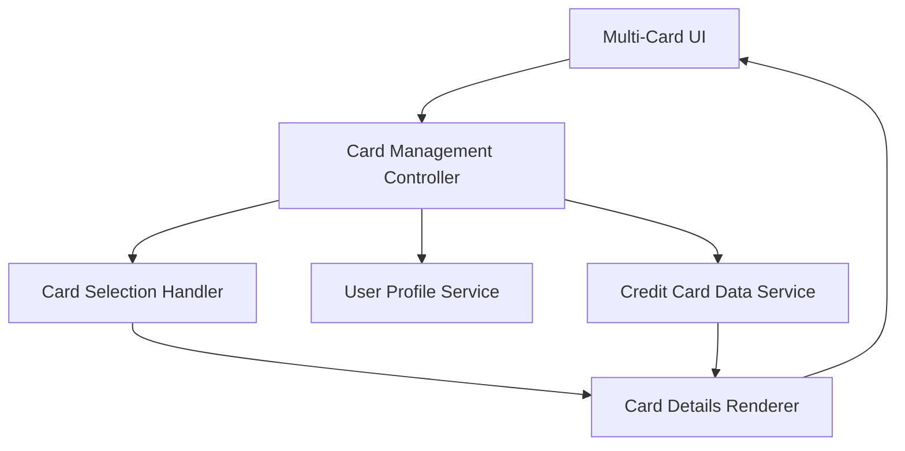

#### 1. High-Level Design

- **Summary:** This epic enables users to manage and view multiple credit cards (minimum 10 per user) within a unified interface, providing detailed visibility into each card's attributes (limits, balances, status), supporting seamless card switching, and enabling card-wise spend analysis and comparison across the user's credit card portfolio.

- **Component Flow:**

- **Integration Points:**
  - **Upstream:** Credit Card Data Service (provides card information including limits, balances, and status)
  - **Upstream:** User Profile Service (associates credit cards with user accounts and manages card portfolio)
  - **Downstream:** Multi-Card UI (displays card list, details, and enables switching)

- **Key Assumptions:**
  - Card data is indexed and cached appropriately to achieve sub-100ms card switching response time; caching strategy ensures data consistency.
  - User Profile Service maintains the authoritative list of cards associated with each user account.

- **NFR Highlights:** System must support minimum 10 credit cards per user; Card switching must be instantaneous with sub-100ms response time; UI must maintain performance with increasing number of cards.

- **Data Flow:** User logs in → Card Management Controller fetches user's card portfolio from User Profile Service → Credit Card Data Service retrieves detailed information for all associated cards → Multi-Card UI displays card list with summary information → User selects a card via Card Selection Handler → Card Details Renderer fetches and displays comprehensive card-wise details (limits, balances, spend analysis, outstanding balance) with sub-100ms response time → User can switch between cards seamlessly to compare usage patterns.

#### 2. Validation Report

- **Requirements Coverage:** The design fully satisfies the epic scope including multiple card display, card-wise details view, card selection and switching, card-wise spend analysis, and per-card credit limit and outstanding balance tracking. The architecture is designed to meet all NFRs: support for minimum 10 cards per user (scalable beyond), sub-100ms card switching through efficient data handling and caching, and maintained UI performance with increasing card counts. Integrations with Credit Card Data Service and User Profile Service align with stated dependencies. Out-of-scope items (real bank integration, card payments, adding external bank cards, card application process) are appropriately excluded from the design.