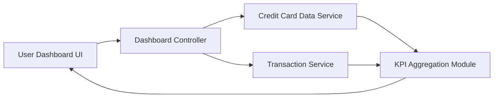

#### 1. High-Level Design

- **Summary:** This epic provides a consolidated financial dashboard that displays critical credit card metrics including monthly spend, total credit limit, available credit, and outstanding amounts aggregated across all user credit cards, offering a single-pane-of-glass view for comprehensive financial health monitoring.

- **Component Flow:**

- **Integration Points:**
  - **Upstream:** Credit Card Data Service (retrieves card balances and credit limits)
  - **Upstream:** Transaction Service (calculates monthly spend and outstanding amounts)
  - **Downstream:** User Dashboard UI (displays consolidated KPI metrics)

- **Key Assumptions:**
  - Real-time data refresh implies near-real-time synchronization with backend services (within acceptable latency thresholds); actual refresh frequency is configurable.
  - Available credit is calculated as (Total Credit Limit - Outstanding Amount) using data from Credit Card Data Service.

- **NFR Highlights:** Dashboard must load within 2 seconds; System must support real-time data refresh; Responsive design must work across desktop, tablet, and mobile devices; Data accuracy must be maintained at 99.9%.

- **Data Flow:** User accesses dashboard → Dashboard Controller initiates parallel requests to Credit Card Data Service (for card balances and limits) and Transaction Service (for monthly spend and outstanding amounts) → KPI Aggregation Module consolidates data across all cards, calculating total credit limit, available credit, and aggregated outstanding amounts → Consolidated metrics are rendered in responsive dashboard layout on User Dashboard UI with real-time refresh capability.

#### 2. Validation Report

- **Requirements Coverage:** The design comprehensively addresses all scope elements: monthly spend display, total credit limit aggregation, available credit calculation, outstanding amount tracking, consolidated KPI view, and responsive dashboard layout. The architecture supports all specified NFRs including 2-second load time, real-time data refresh, cross-device responsiveness, and 99.9% data accuracy through proper integration with authoritative data sources. Dependencies on Credit Card Data Service and Transaction Service are properly incorporated. Out-of-scope items (real bank integration, payments, fund transfers, loans, payment gateway) are correctly excluded.