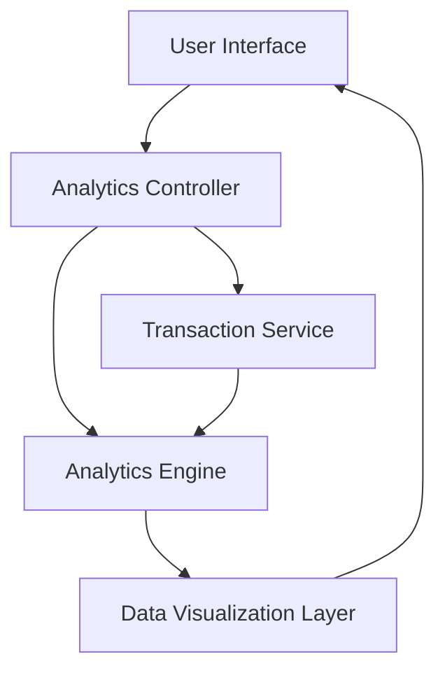

#### 1. High-Level Design

- **Summary:** This epic delivers interactive spending analytics capabilities that enable users to visualize and analyze their credit card expenditure patterns through monthly trends and category-wise breakdowns across nine predefined spending categories (Food & Dining, Fuel, Shopping, Travel, Entertainment, Utilities, Healthcare, Education, Miscellaneous).

- **Component Flow:**

- **Integration Points:** 
  - **Upstream:** Transaction Service (provides transaction data and categorization)
  - **Upstream:** Analytics Engine (performs data aggregation and trend calculation)
  - **Downstream:** User Interface (consumes analytics data for visualization)

- **Key Assumptions:** 
  - Transactions are pre-categorized by the Transaction Service using a standardized categorization logic; category mapping rules are maintained externally.
  - Historical transaction data is available for at least 12 months for all active credit cards.

- **NFR Highlights:** Analytics queries must return results within 3 seconds; Visualizations must support up to 12 months of historical data; Charts must be interactive and responsive across all device types.

- **Data Flow:** User requests spending analytics through the UI → Analytics Controller fetches transaction data from Transaction Service → Data is sent to Analytics Engine for aggregation, trend calculation, and category-wise breakdown → Processed analytics results are formatted by Data Visualization Layer → Interactive charts and graphs are rendered in the User Interface showing monthly trends and category distributions.

#### 2. Validation Report

- **Requirements Coverage:** The design fully covers the epic's stated scope including monthly spend trend visualization, category-wise spending analysis, interactive charts/graphs, and transaction categorization across all nine specified categories. The component architecture supports the NFRs for query performance (3 seconds), historical data support (12 months), and responsive interactive visualizations. Integration with Transaction Service and Analytics Engine aligns with stated dependencies. Out-of-scope items (real bank integration, predictive analytics, budget creation, spending alerts, custom categories) are appropriately excluded from the design.