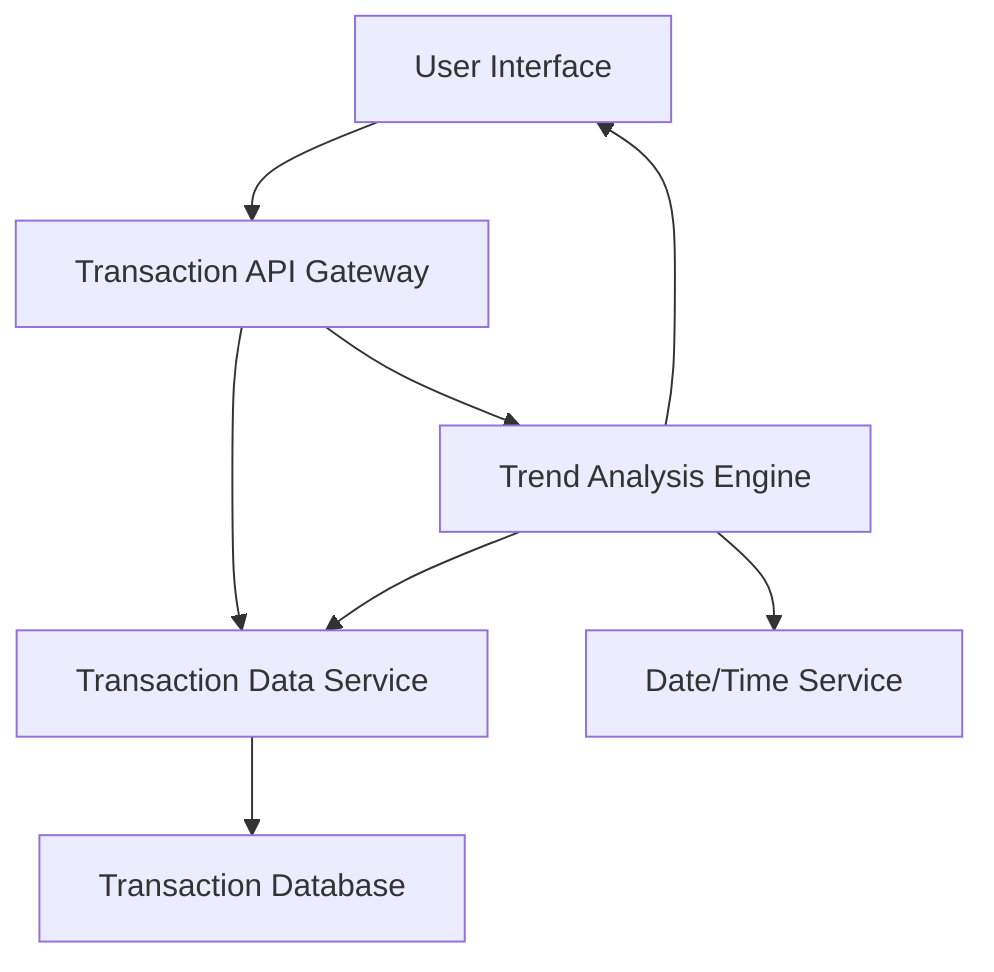

#### 1. High-Level Design

- **Summary:** This epic delivers comprehensive transaction tracking and monthly spending trend analysis capabilities. Users can view detailed transaction histories across all credit cards, analyze spending patterns over time through visualizations, and understand monthly expenditure evolution to support data-driven budgeting and credit card usage optimization.

- **Component Flow:**

- **Integration Points:** 
  - **Upstream:** Transaction data service for retrieving comprehensive transaction history
  - **Downstream:** Date/time service for temporal analysis and time-based aggregations
  - **Downstream:** Credit card service for card-specific transaction filtering
  - **Data Sources:** Transaction database with historical transaction records

- **Key Assumptions:** 
  - Monthly spend trends are calculated based on transaction posting dates (not authorization dates); historical data availability assumed for at least 12-24 months
  - Multi-card transaction aggregation assumes a common user identifier linking all cards to a single user account

- **NFR Highlights:** Transaction data displayed with minimal latency; system handles large transaction volumes efficiently; responsive design across all device types; data accuracy and consistency for all transaction records

- **Data Flow:** User requests transaction history or trend analysis → Transaction API Gateway authenticates and routes request → Transaction Data Service queries Transaction Database with filters (date range, card, amount) → For trend analysis, Trend Analysis Engine aggregates transactions by month using Date/Time Service → Historical spending data processed and formatted → Transaction list and/or trend visualizations (line charts, bar graphs) returned to User Interface → Responsive UI renders transaction details and monthly trend graphs across devices

#### 2. Validation Report

- **Requirements Coverage:** The design fully addresses the epic's scope including monthly spend trend visualization, transaction listing, transaction history tracking, time-based spending analysis, and multi-card transaction aggregation. The architecture supports minimal latency and large transaction volumes through efficient database indexing and query optimization strategies.

- **Traceability:** 
  - Monthly spend trend visualization → Trend Analysis Engine + Date/Time Service
  - Transaction listing and display → Transaction Data Service + User Interface
  - Transaction history tracking → Transaction Database with historical data retention
  - Time-based spending analysis → Trend Analysis Engine with temporal aggregation
  - Multi-card transaction aggregation → Transaction API Gateway with cross-card querying

- **Gaps/Risks:** 
  - **Data Volume Performance:** "Large transaction volumes" not quantified; may need pagination, virtualization, or lazy loading for users with extensive histories
  - **Latency Definition:** "Minimal latency" is subjective; specific SLA targets (e.g., <500ms) would improve measurability
  - **Data Consistency:** Real-time transaction updates vs. batch processing not specified; may impact data freshness and accuracy

- **Compliance & Security Considerations:** 
  - PCI-DSS compliance for storing and displaying transaction details (merchant names, amounts, dates)
  - Encryption of transaction data in transit (TLS) and at rest (database encryption)
  - Access control to ensure users only view their own transactions
  - Data retention and purging policies for transaction history (regulatory compliance)
  - Audit logging for transaction data access and queries
  - Secure handling of sensitive transaction metadata (location, merchant details)