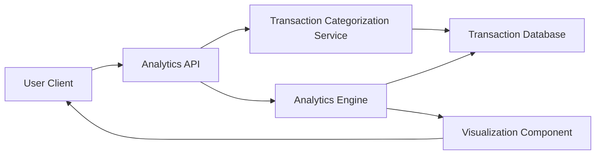

#### 1. High-Level Design

- **Summary:** This epic provides interactive analytics and visualizations for category-wise spending analysis across multiple credit cards. Users can view spending breakdowns across nine predefined categories (Food & Dining, Fuel, Shopping, Travel, Entertainment, Utilities, Healthcare, Education, Miscellaneous) with card-wise drill-down capabilities to optimize rewards and budgeting decisions.

- **Component Flow:**

- **Integration Points:** 
  - **Upstream:** Transaction categorization service for automatic expense classification into predefined categories
  - **Downstream:** Credit card service for card-wise filtering and transaction retrieval
  - **Analytics Engine:** For data aggregation, multi-dimensional analysis, and real-time filtering
  - **Data Sources:** Transaction database with categorized spending data

- **Key Assumptions:** 
  - Transactions are pre-categorized by the Transaction Categorization Service using rule-based or ML-based classification; manual recategorization by users is out of scope
  - Category definitions (Food & Dining, Fuel, etc.) are standardized and mapped from merchant category codes (MCC) or transaction descriptions

- **NFR Highlights:** Analytics visualizations must render within 3 seconds; interactive charts must support responsive interactions; accurate categorization and aggregation; real-time category updates and filtering

- **Data Flow:** User selects analysis parameters (date range, cards, categories) → Analytics API receives request → Transaction Categorization Service retrieves and classifies transactions from Transaction Database → Analytics Engine aggregates spending by category and card → Visualization Component generates interactive charts (bar, pie, trend graphs) → Rendered visualizations returned to client with drill-down capabilities → User interacts with charts to filter and explore spending patterns

#### 2. Validation Report

- **Requirements Coverage:** The design comprehensively covers all aspects of the epic including category-wise visualization for all nine specified categories, interactive analytics charts, card-wise spend analysis, and multi-dimensional insights. The architecture supports the 3-second rendering NFR through pre-aggregation and efficient query patterns.

- **Traceability:** 
  - Category-wise spending visualization → Analytics Engine + Visualization Component
  - Interactive analytics charts → Visualization Component with client-side interactivity
  - Card-wise spend analysis → Credit Card Service filtering + Analytics Engine aggregation
  - Spending breakdown by [each category] → Transaction Categorization Service + Analytics Engine
  - Multi-dimensional spending insights → Analytics Engine with multi-axis aggregation capabilities

- **Gaps/Risks:** 
  - **Categorization Accuracy:** Quality of insights depends on accuracy of Transaction Categorization Service; misclassified transactions may skew analysis
  - **Data Volume:** Large transaction histories may impact 3-second rendering target; may require data sampling or progressive loading
  - **Category Customization:** Epic does not specify if users can create custom categories or only use predefined ones

- **Compliance & Security Considerations:** 
  - Transaction data must be anonymized or masked appropriately in analytics views to protect sensitive merchant/transaction details
  - Access control to ensure users only analyze their own transaction data
  - Data retention policies for historical transaction analytics (compliance with financial regulations)
  - Secure API endpoints with authentication and authorization for analytics requests
  - Audit trails for data access and analysis activities