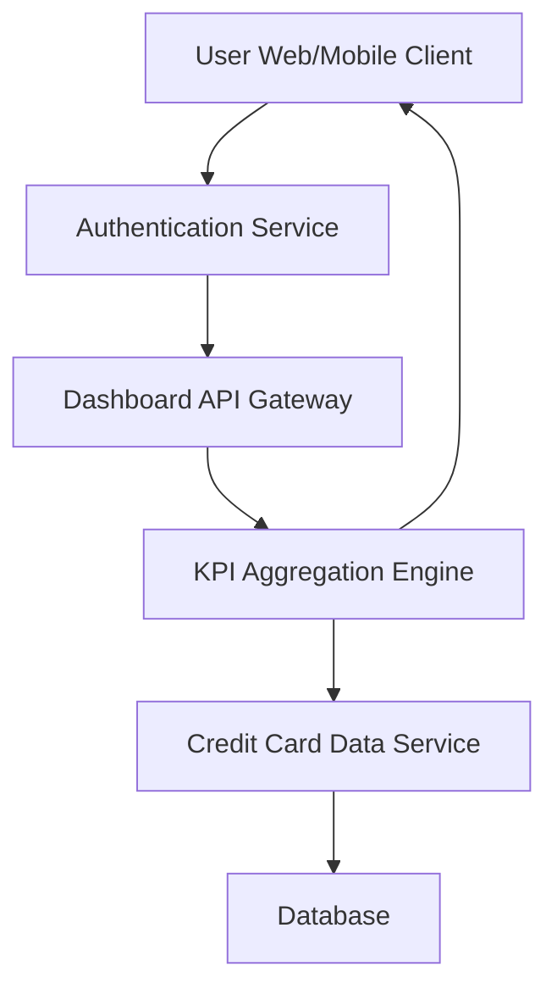

#### 1. High-Level Design

- **Summary:** This epic delivers a consolidated dashboard interface that displays key performance indicators (KPIs) for users' credit cards including monthly spend, total credit limit, available credit, and outstanding amounts. The dashboard aggregates data from multiple credit cards to provide a unified financial snapshot with real-time updates.

- **Component Flow:**

- **Integration Points:** 
  - **Upstream:** User authentication service for secure access validation
  - **Downstream:** Credit card data service for retrieving card details, balances, and transaction summaries
  - **Data Sources:** User profile database, credit card master data, transaction database

- **Key Assumptions:** 
  - Credit card data is refreshed at regular intervals (assumed near real-time, e.g., every 5-15 minutes) from the credit card data service
  - KPI calculations (monthly spend, available credit, outstanding amount) are pre-aggregated or computed on-demand with caching for performance

- **NFR Highlights:** Dashboard must load within 2 seconds; support responsive layouts across desktop and mobile; real-time data refresh for KPIs; support unlimited credit cards per user

- **Data Flow:** User authenticates → Dashboard API Gateway validates session → KPI Aggregation Engine fetches credit card details from Credit Card Data Service → Data retrieved from database includes card limits, balances, and transaction summaries → Aggregation Engine calculates KPIs (monthly spend, total limit, available credit, outstanding) → Consolidated KPI data returned to client → Dashboard renders responsive UI with real-time metrics

#### 2. Validation Report

- **Requirements Coverage:** The design fully covers the epic's stated scope including all four KPIs (monthly spend, total credit limit, available credit, outstanding amount), multiple credit card management, and consolidated interface. The architecture supports responsive design, real-time refresh, and scalability for unlimited cards per user as specified in NFRs.

- **Traceability:** 
  - Dashboard KPI display for monthly spend → KPI Aggregation Engine + Dashboard UI
  - Dashboard KPI display for total credit limit → Credit Card Data Service + KPI Aggregation
  - Dashboard KPI display for available credit → Calculated from limit and outstanding via Aggregation Engine
  - Dashboard KPI display for outstanding amount → Credit Card Data Service + Database
  - Multiple credit card view → Dashboard UI with card list iteration
  - Consolidated interface → Dashboard API Gateway + KPI Aggregation Engine

- **Gaps/Risks:** 
  - **Performance Risk:** Achieving 2-second load time with unlimited cards may require pagination or lazy loading strategies not explicitly defined
  - **Data Freshness:** "Real-time" refresh frequency not specified; may need clarification on acceptable latency
  - **Error Handling:** No specification for handling partial failures when some credit card data is unavailable

- **Compliance & Security Considerations:** 
  - User authentication service integration ensures secure access control
  - Credit card data must be encrypted in transit (HTTPS/TLS) and at rest
  - PCI-DSS compliance considerations for handling credit card information (masked card numbers, secure storage)
  - Role-based access control (RBAC) to ensure users only see their own credit cards
  - Audit logging for access to sensitive financial data