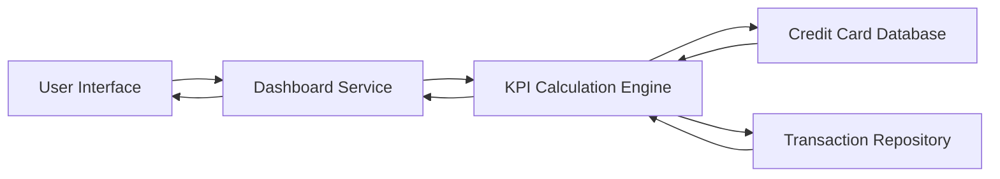

#### 1. High-Level Design

- **Summary:** This epic creates a consolidated dashboard that displays key performance indicators for the user's entire credit card portfolio. The dashboard provides real-time visibility into monthly spend, total credit limit, available credit, and outstanding amounts across multiple credit cards, enabling users to monitor their overall credit card financial health from a single interface.

- **Component Flow:**

- **Integration Points:** 
  - **Upstream:** Credit card data source or database for retrieving card details, balances, and limits; Transaction data for calculating monthly spend
  - **Downstream:** Dashboard UI components for displaying KPIs and credit card overview

- **Key Assumptions:** 
  - Available credit is calculated as (Total Credit Limit - Outstanding Amount) in real-time upon dashboard load
  - Monthly spend is calculated for the current calendar month from the first day to the current date

- **NFR Highlights:** System must provide responsive layouts across devices; Dashboard load time must be under 2 seconds; Support real-time calculation of available credit and outstanding amounts

- **Data Flow:** User accesses the dashboard → Dashboard Service requests KPI data → KPI Calculation Engine retrieves credit card details (limits, balances) from Credit Card Database → Engine queries Transaction Repository for current month's transactions → Real-time calculations performed: total credit limit (sum across all cards), available credit (limit minus outstanding), outstanding amounts, and monthly spend → Aggregated KPIs are returned to Dashboard Service → Dashboard UI renders consolidated view showing all credit cards with their individual and portfolio-level metrics in a responsive layout optimized for sub-2-second load time.

#### 2. Validation Report

- **Requirements Coverage:** The design fully satisfies the epic's scope including Dashboard KPIs display, monthly spend tracking, total credit limit aggregation, available credit calculation, outstanding amount tracking, multiple credit card view, and consolidated credit card interface. The architecture addresses all NFRs through optimized query patterns for sub-2-second load times, real-time calculation capabilities, and responsive UI design. Integration dependencies with the credit card database and transaction data sources are properly mapped in the component flow.