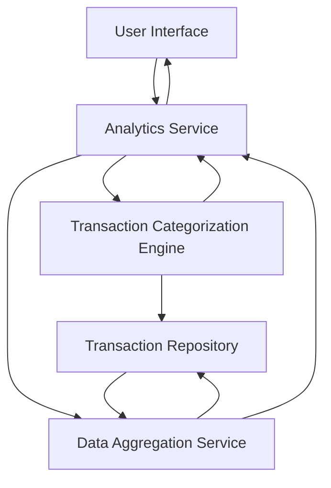

#### 1. High-Level Design

- **Summary:** This epic delivers an interactive analytics platform that visualizes spending patterns through category-wise breakdowns and monthly trends. Users can analyze spending across nine predefined categories (Food & Dining, Fuel, Shopping, Travel, Entertainment, Utilities, Healthcare, Education, Miscellaneous) with card-wise analysis and time-series trend visualization to support data-driven financial decisions.

- **Component Flow:**

- **Integration Points:** 
  - **Upstream:** Analytics engine or service for data aggregation and calculation; Transaction categorization service or logic for mapping transactions to spending categories
  - **Downstream:** Interactive charting library for rendering visualizations; User interface for displaying analytics dashboards

- **Key Assumptions:** 
  - Transaction categorization logic is either pre-applied to stored transactions or performed in real-time using merchant codes or merchant names
  - Monthly trends will display data for the current month and up to 12 previous months by default

- **NFR Highlights:** Visualizations must render within 3 seconds; Support interactive filtering and drill-down capabilities; Charts must be responsive and mobile-friendly

- **Data Flow:** User accesses analytics dashboard → Analytics Service requests aggregated data → Data Aggregation Service queries Transaction Repository and groups by category, card, and time period → Transaction Categorization Engine maps transactions to spending categories → Aggregated results are calculated (totals, percentages, trends) → Analytics Service formats data for visualization → Interactive charts and graphs are rendered in the UI showing category-wise spending, monthly trends, and card-wise analysis with drill-down capabilities.

#### 2. Validation Report

- **Requirements Coverage:** The design comprehensively addresses all scope elements including category-wise spending visualization, monthly spend trends analysis, card-wise spend analysis, interactive charts and graphs, and spending pattern identification across all nine specified categories. The architecture supports the NFRs through optimized data aggregation, responsive charting libraries, and interactive filtering capabilities. All dependencies on analytics engines and transaction categorization services are incorporated into the component flow.