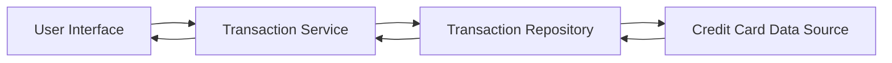

#### 1. High-Level Design

- **Summary:** This epic provides a comprehensive transaction management interface enabling users to view, track, and verify all credit card transactions across multiple cards. The solution aggregates transaction data from various credit cards into a unified view with detailed transaction history and supports efficient handling of high-volume transaction records through pagination.

- **Component Flow:**

- **Integration Points:** 
  - **Upstream:** Transaction data repository or service for retrieving historical and current transaction records
  - **Downstream:** User interface components for displaying transaction lists and details

- **Key Assumptions:** 
  - Transaction data is pre-categorized and stored in a structured format accessible via API or database queries
  - Pagination will default to 50 transactions per page unless specified otherwise

- **NFR Highlights:** System must handle high volume of transaction records efficiently; Transaction data must be displayed with minimal latency; Support pagination for large transaction datasets

- **Data Flow:** User requests transaction history through the UI → Transaction Service queries the Transaction Repository → Repository fetches data from Credit Card Data Source → Transaction records are returned with pagination support → Service aggregates multi-card transactions → Formatted transaction list is displayed to the user with details including date, merchant, amount, card used, and transaction status.

#### 2. Validation Report

- **Requirements Coverage:** The design fully covers the epic's stated scope including transaction listing, transaction history view, multi-card transaction aggregation, and transaction details display. The architecture supports the NFRs for high-volume handling through pagination and minimal latency through direct repository access. All integration points with the transaction data repository are addressed.