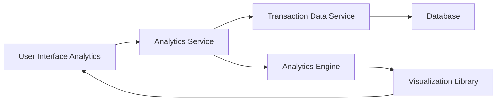

#### 1. High-Level Design

- **Summary**: This epic provides interactive analytics and visualization capabilities enabling users to understand spending patterns through category-wise analysis, monthly trends, and card-wise comparisons. It supports 9 predefined spending categories and delivers actionable insights for financial planning and budget management.

- **Component Flow**:

- **Integration Points**: 
  - **Upstream**: User Interface (for interactive chart rendering and user interactions)
  - **Downstream**: Transaction Data Service (for raw transaction data), Analytics Engine (for data aggregation, categorization, and trend analysis), Visualization Library (for rendering interactive charts and graphs)

- **Key Assumptions**: 
  - Transactions are pre-categorized into 9 predefined categories (Food & Dining, Fuel, Shopping, Travel, Entertainment, Utilities, Healthcare, Education, Miscellaneous) by upstream systems.
  - Historical data aggregation is performed asynchronously and cached to meet the 1.5-second rendering requirement.

- **NFR Highlights**: Analytics visualizations must render within 1.5 seconds; System must support data aggregation for up to 12 months of historical data; Charts must be responsive and interactive across all device types.

- **Data Flow**: User navigates to analytics section → Analytics Service retrieves transaction data from Transaction Data Service → Analytics Engine aggregates data by category, time period, and card → Engine computes spending trends and patterns → Visualization Library renders interactive charts (category breakdown, monthly trends, card-wise comparison) → User interacts with visualizations to explore spending insights and drill down into specific categories or time periods.

#### 2. Validation Report

- **Requirements Coverage**: The design fully addresses the epic's scope including category-wise spending visualization (9 categories), monthly spend trend analysis, card-wise spend analysis, interactive charts/graphs, and spending pattern identification. All NFRs are covered: <1.5 second visualization rendering through caching and optimization, 12-month historical data aggregation via Analytics Engine, and responsive interactive charts via Visualization Library. Integration dependencies with Transaction Data Service, Analytics Engine, and Visualization Library are explicitly mapped and support the required functionality.