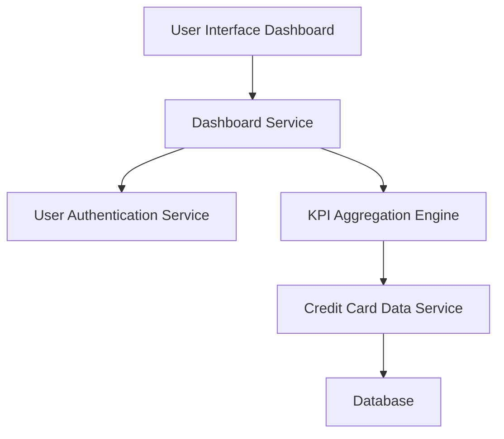

#### 1. High-Level Design

- **Summary**: This epic delivers a consolidated dashboard displaying key performance indicators (KPIs) for the user's credit card portfolio, including monthly spend, total credit limit, available credit, and outstanding amounts. It provides real-time visibility into financial metrics across multiple credit cards through a modern, responsive interface.

- **Component Flow**:

- **Integration Points**: 
  - **Upstream**: User Authentication Service (for secure access and user identification)
  - **Downstream**: Credit Card Data Service (for retrieving card details, balances, limits, and transaction summaries)

- **Key Assumptions**: 
  - Credit card data is refreshed in near real-time (within 5-10 seconds) from backend systems.
  - KPI calculations (monthly spend, available credit) are computed server-side and cached for performance.

- **NFR Highlights**: Dashboard must be responsive across desktop, tablet, and mobile devices; Page load time must be under 2 seconds; System must support real-time data refresh for KPIs with minimal latency.

- **Data Flow**: User logs in and accesses dashboard → Dashboard Service authenticates user → KPI Aggregation Engine queries Credit Card Data Service for all user's cards → Service calculates and aggregates KPIs (monthly spend, total limit, available credit, outstanding amount) → Aggregated KPIs are returned to UI → Dashboard displays consolidated view with real-time refresh capability.

#### 2. Validation Report

- **Requirements Coverage**: The design comprehensively covers all stated scope elements: Dashboard KPIs display (Monthly Spend, Total Credit Limit, Available Credit, Outstanding Amount), multiple credit card management, consolidated view, and responsive layout. All NFRs are addressed including responsive design, <2 second load time, and real-time data refresh through the KPI Aggregation Engine. Integration dependencies with Credit Card Data Service and User Authentication Service are clearly defined.