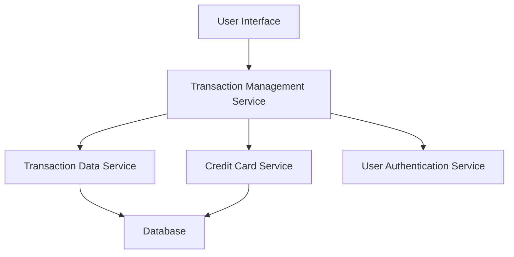

#### 1. High-Level Design

- **Summary**: This epic enables users to view and manage credit card transactions across all registered cards. It provides comprehensive transaction history, detailed transaction views, and multi-card transaction aggregation capabilities to support spending awareness and fraud detection.

- **Component Flow**:

- **Integration Points**: 
  - **Upstream**: User Authentication Service (for access control and user session management)
  - **Downstream**: Transaction Data Service (for retrieving transaction records), Credit Card Service (for card-transaction mapping)

- **Key Assumptions**: 
  - Transaction data is pre-categorized and stored in a structured format with standard fields (date, amount, merchant, category).
  - Transactions are fetched via REST API with pagination support for large datasets.

- **NFR Highlights**: System must handle up to 10,000 transactions per user; Transaction retrieval API latency must be under 300ms; Data must be securely encrypted in transit (TLS) and at rest (AES-256).

- **Data Flow**: User authenticates and requests transaction history → Transaction Management Service validates user session → Service queries Transaction Data Service and Credit Card Service to retrieve and map transactions → Aggregated transaction data is returned to UI → User views transaction list with details including date, merchant, amount, category, and card information.

#### 2. Validation Report

- **Requirements Coverage**: The design fully covers the epic's stated scope including transaction listing, viewing, details display, multi-card aggregation, and history access. All NFRs (10K transactions/user, <300ms latency, encryption) are addressed through appropriate service architecture and security controls. Integration dependencies with Transaction Data Service, Credit Card Service, and User Authentication Service are explicitly mapped in the component flow.