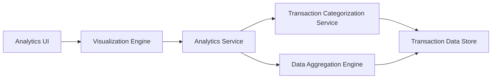

#### 1. High-Level Design

- **Summary:** This epic provides interactive visualizations and analytics to help users understand spending patterns across predefined categories (Food & Dining, Fuel, Shopping, Travel, Entertainment, Utilities, Healthcare, Education, Miscellaneous). The core requirement is to deliver category-wise spending breakdowns and monthly trend analysis through interactive charts that render within 3 seconds, supporting historical data for at least 12 months.

- **Component Flow:**

- **Integration Points:**
  - **Upstream:** Transaction Categorization Service (for classifying expenses into predefined categories), Charting Library (for rendering interactive visualizations)
  - **Downstream:** Analytics Engine (for data aggregation and trend calculation across time periods), Transaction Data Store (for accessing historical transaction data spanning 12+ months)

- **Key Assumptions:**
  - Transactions are pre-categorized or categorized in near-real-time using rule-based or ML-based classification; category assignments are stored with transaction records.
  - Monthly aggregations are pre-computed and cached to meet 3-second rendering requirement; interactive drill-down triggers on-demand calculations.

- **NFR Highlights:** Analytics visualizations must render within 3 seconds, support interactive filtering and drill-down capabilities, handle historical data for minimum 12 months.

- **Data Flow:** User accesses analytics dashboard → Analytics UI requests spending insights from Analytics Service → Service queries Transaction Categorization Service to retrieve categorized transactions → Data Aggregation Engine computes category-wise spending totals and monthly trends from Transaction Data Store (12+ months of historical data) → Aggregated data is formatted for visualization → Visualization Engine renders interactive charts and graphs using charting library → User interacts with visualizations (filtering, drill-down) triggering real-time recalculations → Updated insights are displayed showing spending patterns, category breakdowns, and trend analysis.

#### 2. Validation Report

- **Requirements Coverage:** The design fully addresses the epic's scope including category-wise spending visualization across all 9 predefined categories, monthly spend trends analysis, interactive charts and graphs, and spending pattern identification. The architecture supports the NFR requirements with 3-second rendering through pre-computed aggregations and efficient data retrieval, interactive filtering/drill-down capabilities via the visualization engine, and 12+ months of historical data handling through the transaction data store. Integration dependencies with transaction categorization service, analytics engine, and charting library are clearly defined. The design delivers user value by empowering users with deep insights into spending habits through visual analytics, enabling better budget management and informed financial decisions.