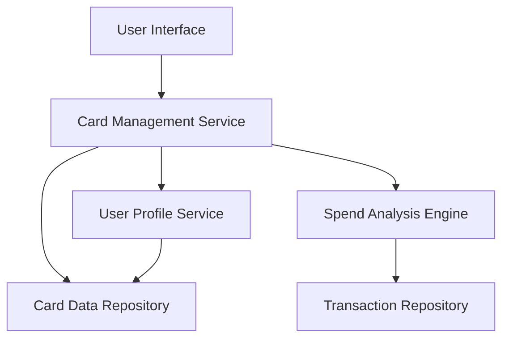

#### 1. High-Level Design

- **Summary:** This epic enables users to manage and monitor multiple credit cards (minimum 10 per user) from a unified interface. The core requirement is to provide card-wise spend analysis, individual card details, and comparison capabilities, allowing users to view, filter, and analyze spending patterns across their entire credit card portfolio with card data retrieval completing within 1 second.

- **Component Flow:**

- **Integration Points:**
  - **Upstream:** User Profile Service (for card ownership validation and user-card relationship management)
  - **Downstream:** Card Data Repository (for storing and retrieving card information including card details, limits, balances), Transaction Repository (for accessing transaction history for card-wise spend analysis)

- **Key Assumptions:**
  - Card data is indexed by user ID and card ID to enable sub-1-second retrieval for up to 10+ cards per user.
  - Card-wise spend analysis aggregates transactions by card ID with pre-computed monthly/weekly summaries stored for performance.

- **NFR Highlights:** System must support minimum 10 credit cards per user, card data retrieval must complete within 1 second, ensure data isolation and security for multi-card views.

- **Data Flow:** User accesses card management interface → Card Management Service validates user identity via User Profile Service → Service retrieves all cards associated with user from Card Data Repository (sub-1-second response) → For selected cards, Spend Analysis Engine fetches transaction data from Transaction Repository → Analysis Engine computes card-wise spending metrics → Results are returned to UI showing multiple card display, individual card details, spend analysis, and comparison views → User can filter and select specific cards for detailed analysis.

#### 2. Validation Report

- **Requirements Coverage:** The design comprehensively addresses the epic's scope including multiple credit card display, card-wise spend analysis, individual card details view, card comparison capabilities, and card selection/filtering. The architecture supports the NFR of minimum 10 cards per user with sub-1-second retrieval through optimized data indexing and repository design. Data isolation and security are ensured through user profile validation and secure data access patterns. The design delivers the stated user value by simplifying credit card portfolio management through a unified interface, reducing complexity and improving financial oversight.