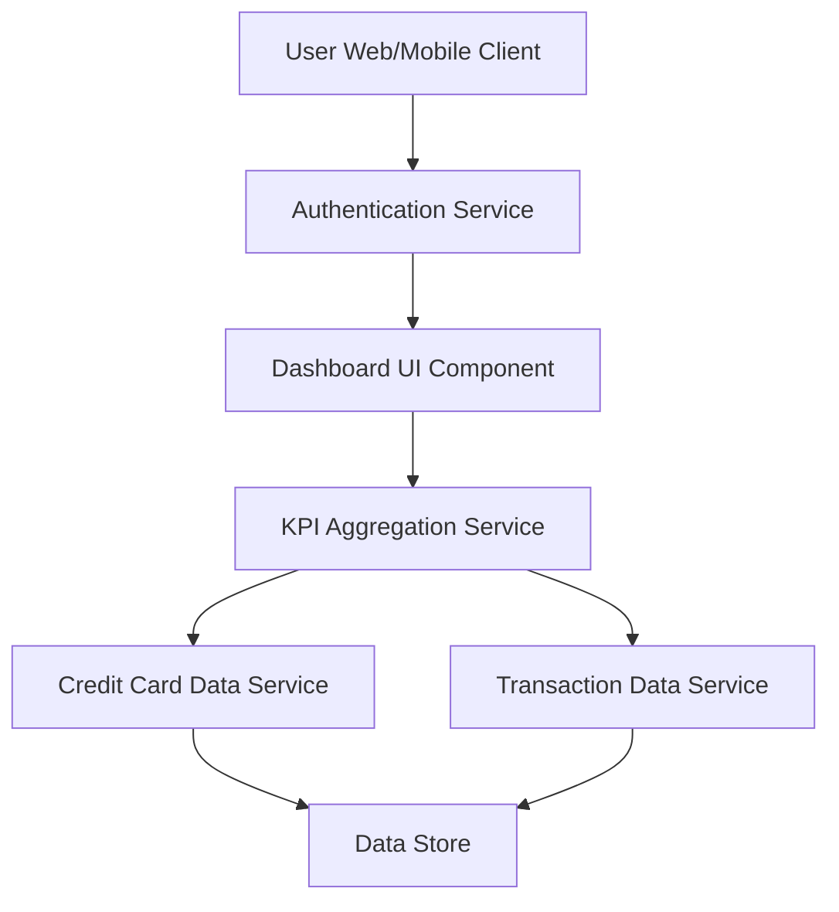

#### 1. High-Level Design

- **Summary:** This epic delivers a centralized dashboard that aggregates and displays key performance indicators (KPIs) for a user's credit card portfolio. The core requirement is to provide real-time visibility into critical financial metrics including monthly spend, total credit limit, available credit, and outstanding amounts through a responsive, consolidated interface that loads within 2 seconds.

- **Component Flow:**

- **Integration Points:**
  - **Upstream:** User Authentication Service (for secure access and user identity validation)
  - **Downstream:** Credit Card Data Service (for fetching card balances, limits, and outstanding amounts), Transaction Data Service (for retrieving transaction history and calculating monthly spend)

- **Key Assumptions:**
  - KPI calculations are performed server-side with cached results refreshed at configurable intervals (e.g., every 5 minutes) to meet 2-second load requirement.
  - Available credit is calculated as (Total Credit Limit - Outstanding Amount) using real-time or near-real-time data.

- **NFR Highlights:** Dashboard must load within 2 seconds, support responsive design across desktop and mobile devices, handle real-time data refresh for KPI updates.

- **Data Flow:** User authenticates via Authentication Service → Dashboard UI requests KPI data from KPI Aggregation Service → Aggregation Service fetches card balances from Credit Card Data Service and transaction totals from Transaction Data Service → Services query Data Store → Aggregated KPIs (monthly spend, total credit limit, available credit, outstanding amounts) are calculated and returned to Dashboard UI → Dashboard renders KPIs in responsive layout for user consumption.

#### 2. Validation Report

- **Requirements Coverage:** The design fully covers the epic's stated scope including monthly spend display, total credit limit tracking, available credit calculation, outstanding amount monitoring, and consolidated dashboard view. The architecture supports responsive layout implementation and meets the 2-second load time NFR through caching and aggregation strategies. Integration points with credit card data service and authentication service are clearly defined. The design aligns with user value by providing instant visibility into overall credit card financial health.