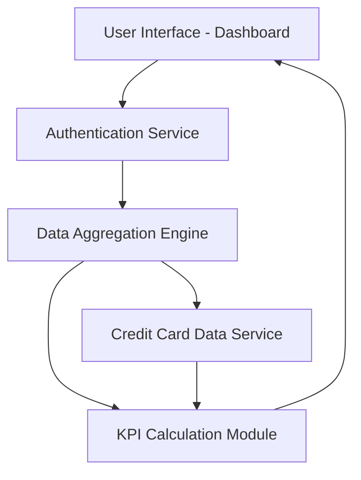

#### 1. High-Level Design

**Summary:**  
This epic delivers a consolidated dashboard that displays key performance indicators (KPIs) for all user credit cards. Users can view monthly spend, total credit limit, available credit, and outstanding amounts in a single interface, providing a comprehensive financial snapshot for informed credit management decisions.

**Component Flow:**

**Integration Points:**
- **Upstream:** Credit card data service (provides raw card data), User authentication service (validates user identity)
- **Downstream:** Data aggregation engine (consolidates multi-card data and calculates KPIs)

**Key Assumptions:**
- Credit card data is refreshed at regular intervals (assumed near real-time or periodic sync from source systems)
- KPI calculations (available credit, outstanding amounts) follow standard financial formulas without custom business rules

**NFR Highlights:**  
Dashboard must load within 2 seconds, support real-time data refresh, responsive design across desktop and mobile, 99.9% data accuracy

#### 2. Validation Report

**Requirements Coverage:**  
The design covers all stated requirements including monthly spend display, credit limit aggregation, available credit calculation, outstanding amount tracking, consolidated multi-card view, and responsive layout. The component flow ensures data flows from authentication through aggregation to presentation, meeting the 2-second load time and real-time refresh NFRs. Integration with credit card data service and authentication service is explicitly addressed.