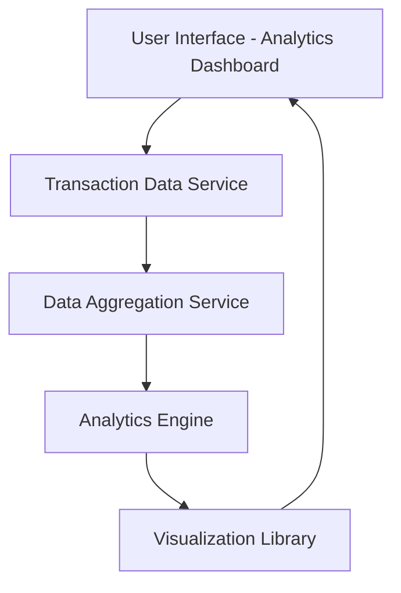

#### 1. High-Level Design

**Summary:**  
This epic provides interactive visualizations and analytical capabilities to help users understand spending patterns. Users can view monthly spend trends and analyze spending distribution across 9 categories (Food & Dining, Fuel, Shopping, Travel, Entertainment, Utilities, Healthcare, Education, Miscellaneous), enabling data-driven budgeting and financial optimization decisions.

**Component Flow:**

**Integration Points:**
- **Upstream:** Transaction data service (provides raw transaction data with category tags), Data aggregation service (consolidates and prepares data for analysis)
- **Downstream:** Analytics engine (processes spending patterns and trends), Visualization library (renders interactive charts and graphs)

**Key Assumptions:**
- Transactions are pre-categorized into the 9 specified categories by upstream systems (categorization logic not detailed in epic)
- Historical data retention supports at least 12 months as per NFR, with monthly granularity for trend analysis

**NFR Highlights:**  
Visualizations must render within 1 second, analytics must support at least 12 months of historical data, charts must be interactive and responsive across all devices

#### 2. Validation Report

**Requirements Coverage:**  
The design fully covers the epic's scope including category-wise spending visualization, monthly spend trend analysis, interactive charts, and spending pattern identification across all 9 specified categories. The component flow ensures efficient data processing from transaction service through aggregation and analytics to visualization. The 1-second rendering NFR is supported by optimized data aggregation and visualization library integration. The 12-month historical data requirement is explicitly addressed in the analytics engine design.