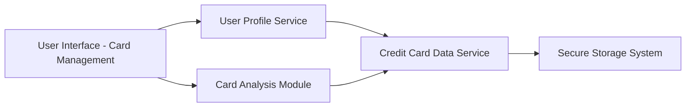

#### 1. High-Level Design

**Summary:**  
This epic enables users to manage and view multiple credit cards (minimum 10 per user) within a single interface. Users can register cards, view card listings, access card-specific details, and perform card-wise spending analysis without switching applications, simplifying portfolio management for multi-card holders.

**Component Flow:**

**Integration Points:**
- **Upstream:** User profile service (manages user identity and card associations), Credit card data service (provides card details and transaction data)
- **Downstream:** Secure storage system (encrypted storage for card data), Card analysis module (processes card-wise spending data)

**Key Assumptions:**
- Card registration process assumes card details are validated externally or via API (validation mechanism not specified)
- Card-wise spend analysis uses transaction data aggregated by card identifier with standard grouping logic

**NFR Highlights:**  
System must support minimum 10 credit cards per user, card data securely stored and encrypted, card switching must be instantaneous with no lag

#### 2. Validation Report

**Requirements Coverage:**  
The design addresses all functional requirements including multiple card registration, card listing view, card-wise spend analysis, individual card details display, and card selection/filtering. The architecture ensures secure storage with encryption and supports the minimum 10-card requirement. Integration with user profile service and credit card data service enables centralized card management. The instantaneous card switching NFR is supported by the direct UI-to-service communication pattern.