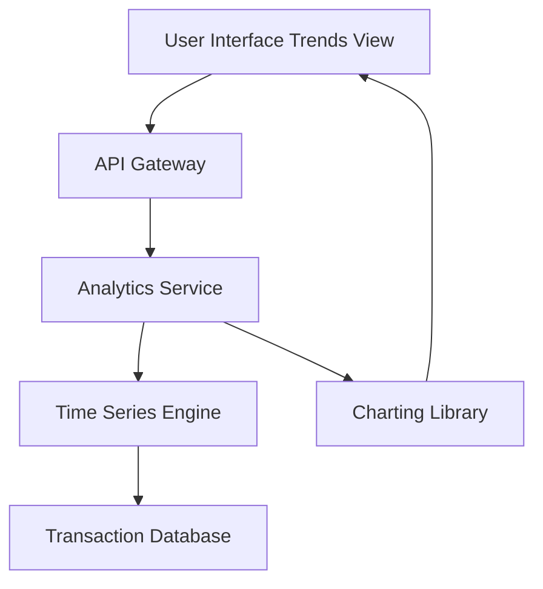

#### 1. High-Level Design

- **Summary:** This epic delivers interactive visualizations and analytical capabilities for understanding spending patterns over time. Users can view monthly spend trends through visual representations (charts and graphs), analyze time-based spending patterns, and perform card-wise spend analysis using historical transaction data.

- **Component Flow:**

- **Integration Points:** 
  - Transaction data repository for historical spending information
  - Charting library or visualization framework (e.g., Chart.js, D3.js) for rendering interactive graphs
  - No external bank integrations (explicitly out of scope)

- **Key Assumptions:** 
  - Historical transaction data is available for at least 6-12 months for meaningful trend analysis
  - Monthly spend is aggregated by transaction date, not by billing cycle date

- **NFR Highlights:** Efficient rendering with smooth interactions; responsive charts adapting to different screen sizes; no performance degradation with multi-month historical data

- **Data Flow:** User accesses the trends and analytics view, sending a request through the API Gateway to the Analytics Service. The service queries the Time Series Engine, which retrieves historical transaction data from the Transaction Database, aggregating spending by month and optionally by credit card. The aggregated time-series data is processed and passed to the Charting Library, which renders interactive visualizations (line charts, bar charts) showing month-over-month spending trends. Users can interact with charts to filter by date range or specific cards.

#### 2. Validation Report

- **Requirements Coverage:** The design comprehensively covers all scope elements including monthly spend trend visualization, interactive charts and graphs, time-based spending analysis, card-wise spend analysis, and historical spending data display. NFRs regarding efficient rendering, responsive design, and performance with historical data are addressed through the Time Series Engine and optimized data retrieval. The design appropriately excludes predictive spending forecasts and real bank integrations as per the out-of-scope statement.