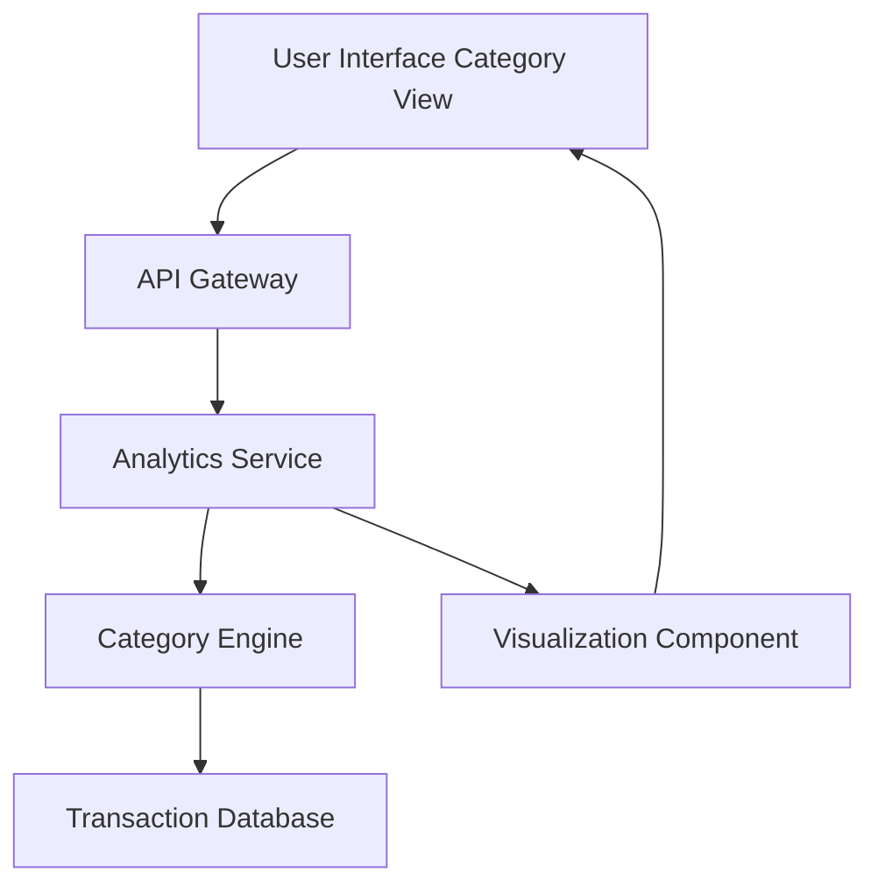

#### 1. High-Level Design

- **Summary:** This epic provides detailed spending breakdowns across predefined categories (Food & Dining, Fuel, Shopping, Travel, Entertainment, Utilities, Healthcare, Education, Miscellaneous) through interactive visualizations. Users can view expenditure distribution by category to identify spending patterns and opportunities for savings.

- **Component Flow:**

- **Integration Points:** 
  - Transaction categorization engine or pre-categorized transaction data source
  - Transaction database containing category-tagged expenses
  - Charting/visualization library for rendering interactive category charts

- **Key Assumptions:** 
  - Transactions are pre-categorized in the database (automatic AI/ML categorization is out of scope)
  - Category definitions are predefined and fixed (custom category creation is out of scope)

- **NFR Highlights:** Real-time accurate category calculations; drill-down capabilities for detailed transaction views; efficient handling of large transaction volumes

- **Data Flow:** User accesses the category analysis view, triggering a request through the API Gateway to the Analytics Service. The service invokes the Category Engine to query the Transaction Database for all transactions grouped by predefined categories. Aggregated category spending data is passed to the Visualization Component, which renders interactive charts (e.g., pie charts, bar charts) showing expenditure distribution. Users can drill down into specific categories to view detailed transactions.

#### 2. Validation Report

- **Requirements Coverage:** The design addresses all scope items including category-wise spending visualization and tracking across all nine predefined categories (Food & Dining, Fuel, Shopping, Travel, Entertainment, Utilities, Healthcare, Education, Miscellaneous) with interactive category charts. NFRs for accuracy, drill-down capabilities, and efficient handling of large transaction volumes are supported through the Category Engine and Analytics Service architecture. The design explicitly excludes custom category creation and AI/ML-based automatic categorization as per the out-of-scope statement.