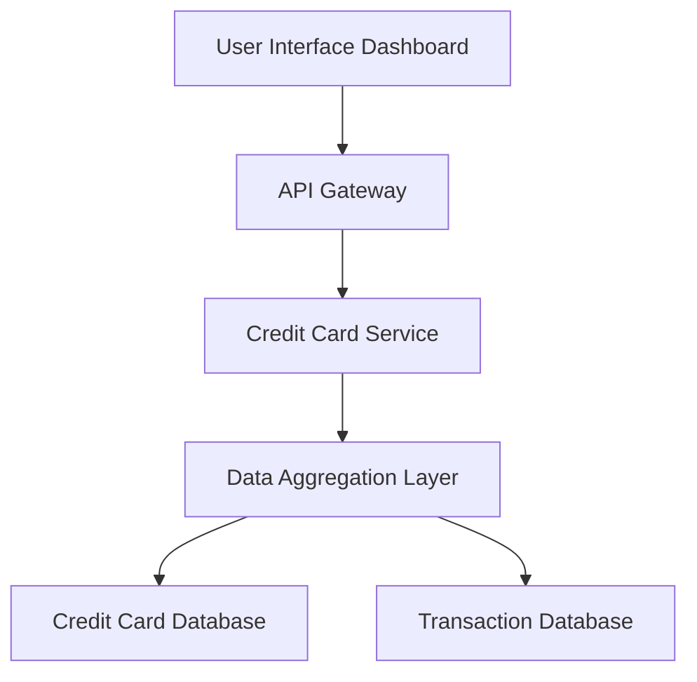

#### 1. High-Level Design

- **Summary:** This epic delivers a consolidated dashboard that displays key performance indicators (KPIs) for a user's credit card portfolio. It aggregates and presents critical financial metrics including monthly spend, total credit limit, available credit, and outstanding amounts across multiple credit cards in a responsive interface, providing users with an at-a-glance view of their credit card health.

- **Component Flow:**

- **Integration Points:** 
  - Credit card data source/database for retrieving card details, balances, and transaction data
  - Transaction database for monthly spend calculations
  - No external bank integrations (explicitly out of scope)

- **Key Assumptions:** 
  - Credit card data is pre-populated in the system database and updated periodically by a backend process
  - Available credit is calculated as (Total Credit Limit - Outstanding Amount) within the application layer

- **NFR Highlights:** Responsive design across desktop, tablet, and mobile devices; optimized page load time; accurate decimal formatting for currency values

- **Data Flow:** User accesses the dashboard UI, which sends a request through the API Gateway to the Credit Card Service. The service queries the Data Aggregation Layer, which retrieves card details (credit limits, outstanding balances) from the Credit Card Database and transaction summaries (monthly spend) from the Transaction Database. Aggregated KPI data is returned through the service layer to the UI for display in a responsive format.

#### 2. Validation Report

- **Requirements Coverage:** The design fully covers the epic's stated scope including dashboard KPIs display, monthly spend tracking, total credit limit aggregation, available credit calculation, outstanding amount tracking, multiple credit card view, and responsive layout design. All NFRs regarding responsiveness, performance, and data accuracy are addressed through the component architecture and data aggregation layer.