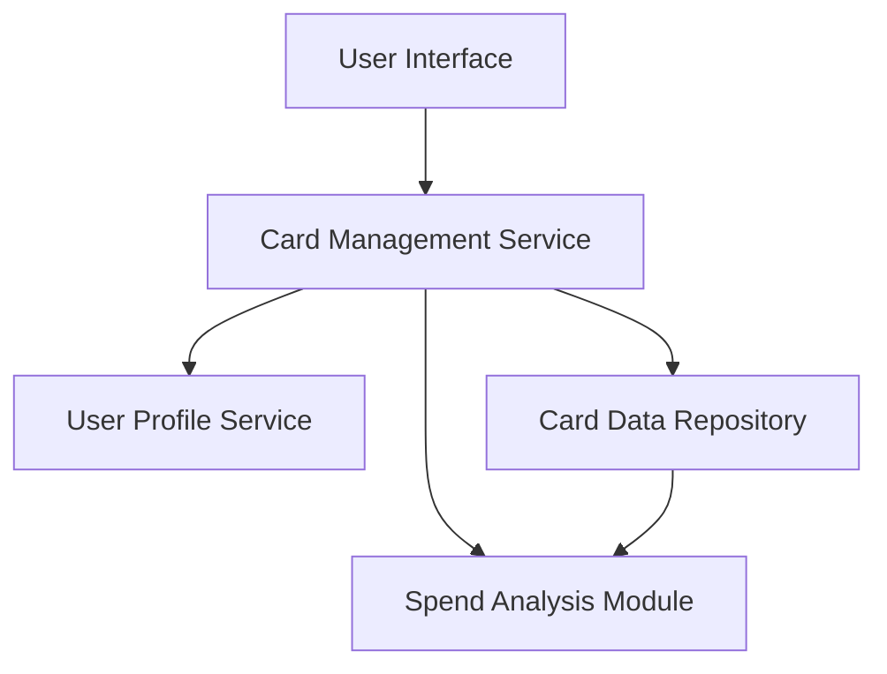

#### 1. High-Level Design

- **Summary:** This epic enables comprehensive multi-card portfolio management within a unified interface, allowing users to add, view, monitor, and compare multiple credit cards. Each card displays essential information including card type, credit limit, available balance, and outstanding amounts, with capabilities for card-wise spend analysis, status tracking, and seamless navigation between cards.

- **Component Flow:**

- **Integration Points:**
  - **Upstream:** User Profile Service (validates card ownership)
  - **Upstream:** Card Data Repository (stores and retrieves card details)

- **Key Assumptions:** 
  - Card ownership validation occurs at session initialization and when adding new cards, not on every card view operation
  - Card comparison logic uses normalized metrics to enable meaningful cross-card analysis

- **NFR Highlights:** System must support minimum 10 credit cards per user; Card data retrieval must complete within 1 second; Card switching must be instantaneous with no lag

#### 2. Validation Report

- **Requirements Coverage:** The design fully satisfies the epic scope covering multiple credit card display, card information management, card-wise spend analysis, individual card status tracking, card comparison capabilities, and card selection/navigation. All NFRs are architecturally addressed: 10+ card support through scalable Card Data Repository, sub-1-second retrieval via optimized data access patterns, and instantaneous switching through client-side caching and efficient Card Management Service. Dependencies on User Profile Service and Card Data Repository are properly integrated into the component flow.