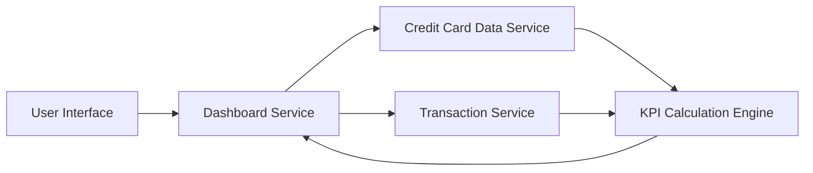

#### 1. High-Level Design

- **Summary:** This epic provides a centralized, real-time dashboard that aggregates and displays key performance indicators across a user's entire credit card portfolio. Users gain instant visibility into monthly spend, total credit limit, available credit, and outstanding amounts through a responsive interface that serves as the primary entry point for monitoring credit card financial health and supporting informed spending decisions.

- **Component Flow:**

- **Integration Points:**
  - **Upstream:** Credit Card Data Service (retrieves card information and balances)
  - **Upstream:** Transaction Service (provides monthly spend calculations)

- **Key Assumptions:** 
  - Real-time data refresh is achieved through periodic polling or event-driven updates from backend services
  - Credit utilization calculations assume standard formula: (Outstanding Amount / Credit Limit) × 100

- **NFR Highlights:** Dashboard must load within 2 seconds; Real-time data refresh support; Responsive across desktop, tablet, and mobile devices; Must handle concurrent users without performance degradation

#### 2. Validation Report

- **Requirements Coverage:** The design comprehensively addresses all scope elements including KPI display, monthly spend tracking, credit limit aggregation, available credit calculation, outstanding amount monitoring, responsive layout, and multi-card consolidated view. All NFRs are architecturally supported: 2-second load time through optimized KPI Calculation Engine, real-time refresh via service integration, responsive design at UI layer, and concurrent user support through stateless Dashboard Service design. Dependencies on Credit Card Data Service and Transaction Service are clearly mapped.