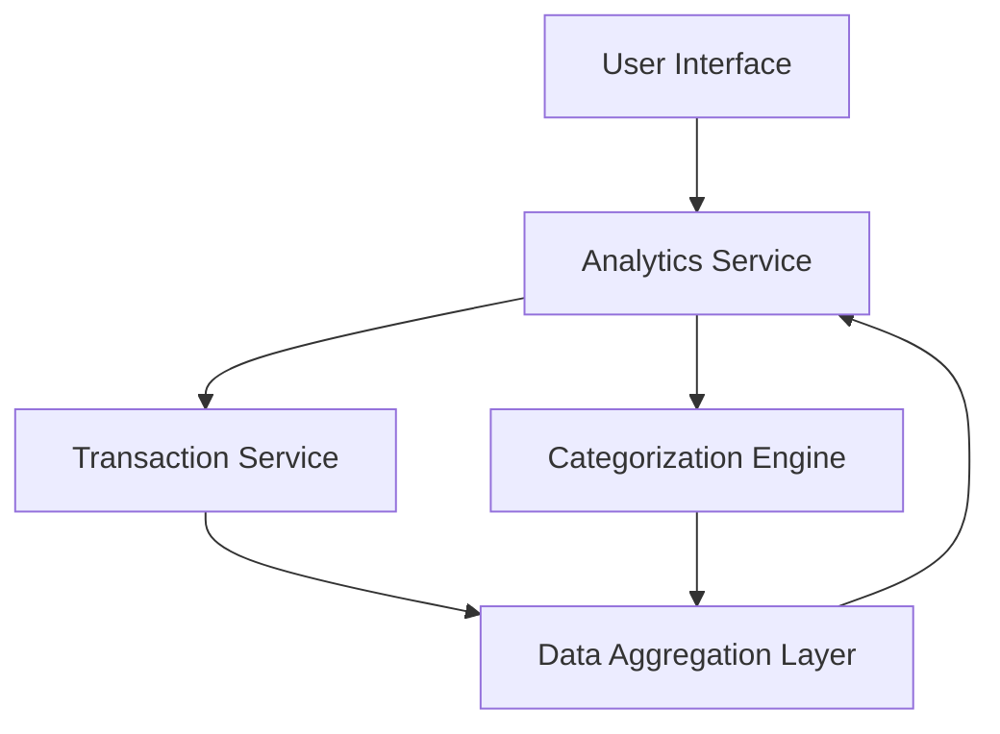

#### 1. High-Level Design

- **Summary:** This epic delivers interactive spending analytics capabilities that enable users to visualize and understand their credit card spending patterns through category-wise breakdowns and monthly trend analysis. The system processes transactions across 9 predefined categories (Food & Dining, Fuel, Shopping, Travel, Entertainment, Utilities, Healthcare, Education, Miscellaneous) and presents insights through interactive charts and graphs to support data-driven financial decisions.

- **Component Flow:**

- **Integration Points:**
  - **Upstream:** Transaction Service (provides raw transaction data)
  - **Upstream:** Categorization Engine (performs automatic transaction classification)
  - **Upstream:** Analytics Service (handles data aggregation and trend calculations)

- **Key Assumptions:** 
  - Transaction data is pre-validated and cleansed before reaching the analytics layer
  - Category assignments follow a deterministic rule-based or ML-based classification model with fallback to "Miscellaneous"

- **NFR Highlights:** Analytics visualizations must render within 3 seconds; System must process up to 10,000 transactions per user; Charts must be interactive with drill-down capabilities; Data aggregation accurate to 2 decimal places

#### 2. Validation Report

- **Requirements Coverage:** The design fully covers the epic's stated scope including category-wise analysis, monthly trend visualization, interactive charts, transaction categorization, pattern identification, multi-category filtering, and historical comparison. All NFRs (3-second render time, 10K transaction capacity, interactivity, decimal precision) are addressed through the layered architecture with dedicated Analytics Service and Categorization Engine. Integration dependencies are satisfied through clearly defined service boundaries.