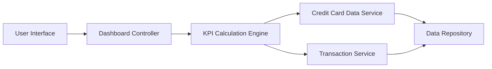

#### 1. High-Level Design

- **Summary:** This epic delivers a consolidated dashboard displaying key performance indicators for the user's credit card portfolio, including monthly spend, total credit limit, available credit, and outstanding amounts across all cards. The dashboard provides a real-time financial snapshot enabling proactive credit management.

- **Component Flow:**

- **Integration Points:**
  - **Upstream:** Credit card data service (fetches card details and balances), Transaction service (provides monthly spend data)
  - **Downstream:** Data repository for persistent storage of card and transaction information

- **Key Assumptions:**
  - KPI calculations are performed server-side and cached for performance; data refresh occurs at configurable intervals (assumed every 5 minutes unless user-triggered).
  - Available credit is calculated as (Total Credit Limit - Outstanding Amount) without considering pending transactions.

- **NFR Highlights:** Dashboard must load within 2 seconds for up to 10 credit cards; real-time KPI calculation required; responsive design for mobile, tablet, and desktop viewports.

#### 2. Validation Report

- **Requirements Coverage:** The design fully covers the epic's stated scope including monthly spend display, credit limit calculation, available credit tracking, outstanding amount monitoring, and consolidated multi-card view. The component flow ensures separation of concerns with dedicated services for data retrieval and KPI calculation, meeting the 2-second load time requirement through efficient service orchestration.