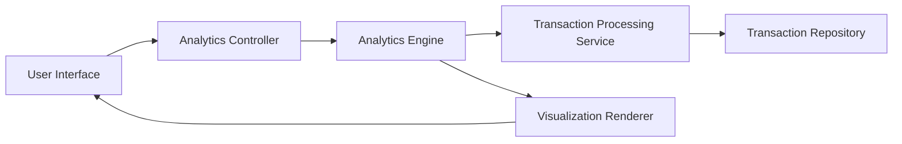

#### 1. High-Level Design

- **Summary:** This epic delivers interactive visualizations and analytics for spending behavior analysis, including monthly spend trends and category-wise spending breakdown across 9 predefined categories (Food & Dining, Fuel, Shopping, Travel, Entertainment, Utilities, Healthcare, Education, Miscellaneous). The feature enables data-driven expense management and budget optimization.

- **Component Flow:**

- **Integration Points:**
  - **Upstream:** Transaction processing service (provides categorized transaction data), Analytics engine (performs trend calculation and pattern recognition)
  - **Downstream:** Transaction repository for historical transaction data storage (minimum 12 months)

- **Key Assumptions:**
  - Transactions are pre-categorized by the transaction processing service using rule-based or ML-based categorization logic.
  - Analytics calculations are performed asynchronously and cached; visualizations render from pre-computed aggregates for performance.

- **NFR Highlights:** Analytics must process and display data for up to 1000 transactions within 3 seconds; visualizations must be interactive and responsive; system must support historical data for minimum 12 months.

#### 2. Validation Report

- **Requirements Coverage:** The design comprehensively covers monthly spend trends visualization, category-wise spending breakdown, interactive charts and graphs, spending pattern analysis across 9 predefined categories, and transaction categorization. The architecture leverages pre-computed aggregates and caching to meet the 3-second processing requirement for 1000 transactions, while the visualization renderer ensures interactive and responsive chart rendering across all device types.