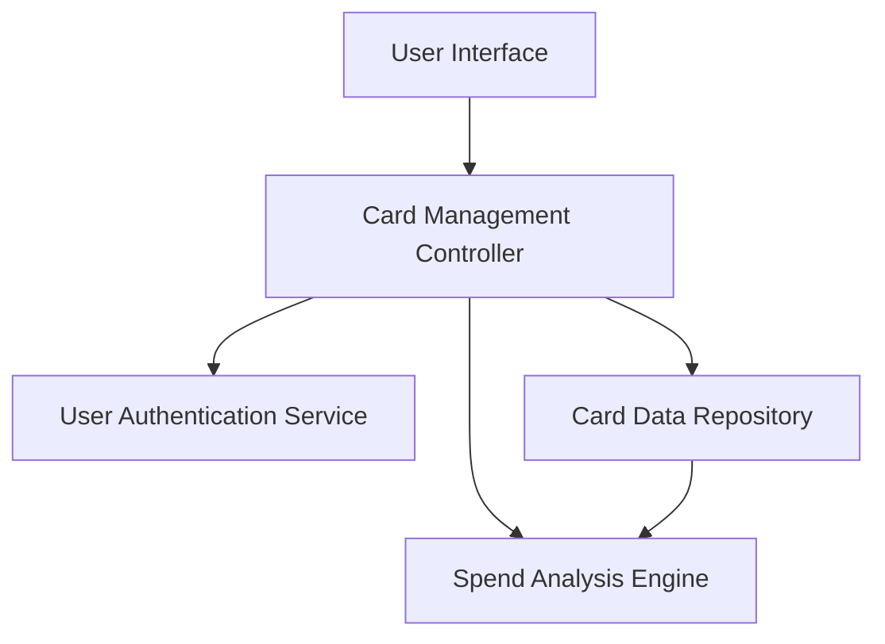

#### 1. High-Level Design

- **Summary:** This epic enables users to manage and view multiple credit cards within a unified interface, supporting card-specific metrics tracking, card-wise spend analysis, and seamless switching between cards for detailed analysis. The feature consolidates portfolio management and eliminates the need for multiple banking portal logins.

- **Component Flow:**

- **Integration Points:**
  - **Upstream:** User authentication service (validates card ownership), Credit card data repository (stores and retrieves card information)
  - **Downstream:** Card data repository for persistent multi-card storage

- **Key Assumptions:**
  - Card data is pre-loaded during user session initialization to meet 1-second retrieval requirement.
  - Card ownership validation occurs once per session; subsequent card operations rely on session token.

- **NFR Highlights:** System must support minimum 20 credit cards per user; card data retrieval must complete within 1 second; UI must maintain performance with multiple cards loaded simultaneously.

#### 2. Validation Report

- **Requirements Coverage:** The design addresses all core requirements including multiple credit card display, card-wise spend analysis, individual card details view, card selection and switching, and card-specific metrics tracking. The architecture supports the NFR of 20+ cards per user through efficient data repository design and session-based caching, ensuring sub-second retrieval times.