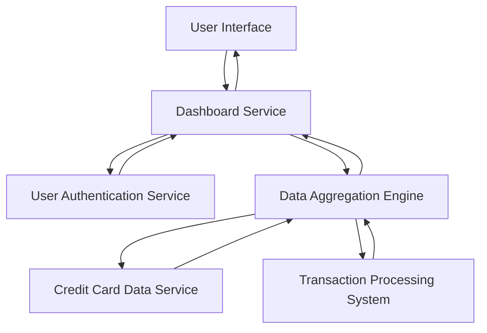

#### 1. High-Level Design

- **Summary:** This epic delivers a consolidated dashboard that displays key performance indicators for a user's credit card portfolio, including monthly spend, total credit limit, available credit, and outstanding amounts across multiple cards. The dashboard provides a unified view for monitoring overall credit card financial health.

- **Component Flow:**

- **Integration Points:**
  - **Upstream:** User authentication service for secure access control
  - **Upstream:** Credit card data source/mock data service for card details (card numbers, limits, balances)
  - **Upstream:** Transaction processing system for spend calculations and outstanding amounts
  - **Downstream:** Dashboard UI layer for rendering KPIs and multi-card views

- **Key Assumptions:**
  - Credit card data is available via API in JSON format with standard fields (card_id, limit, balance, spend)
  - Dashboard refresh occurs on user login or manual refresh; near real-time updates assume polling or event-driven notification mechanism

- **NFR Highlights:** Dashboard must load within 2 seconds for up to 10 credit cards; responsive layouts required across desktop, tablet, and mobile; near real-time data refresh

#### 2. Validation Report

- **Requirements Coverage:** The design covers all stated scope elements including monthly spend display, credit limit aggregation, available credit calculation, outstanding amount tracking, multiple credit card view, and consolidated dashboard interface. The component flow addresses authentication, data retrieval, aggregation, and presentation layers. All identified dependencies (credit card data service, transaction processing system, user authentication) are incorporated into the architecture. NFRs for load time (2 seconds), responsive design, and near real-time refresh are acknowledged and supported by the lightweight aggregation engine and UI service architecture.