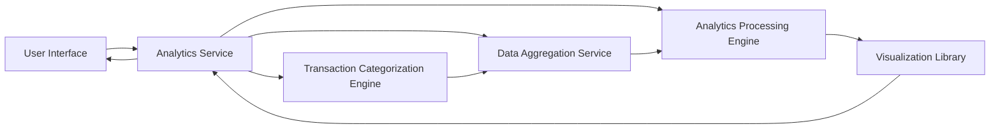

#### 1. High-Level Design

- **Summary:** This epic provides interactive visualizations and analytical capabilities for users to understand spending patterns. Users can analyze monthly spend trends, view card-wise spend breakdowns, and explore category-wise spending across nine predefined categories (Food & Dining, Fuel, Shopping, Travel, Entertainment, Utilities, Healthcare, Education, Miscellaneous) to support data-driven financial planning.

- **Component Flow:**

- **Integration Points:**
  - **Upstream:** Transaction categorization service/engine for assigning transactions to predefined categories
  - **Upstream:** Data aggregation service for calculating spend totals by month, card, and category
  - **Upstream:** Analytics processing engine for trend analysis and pattern identification
  - **Downstream:** Charting/visualization library for rendering interactive charts and graphs in the UI

- **Key Assumptions:**
  - Transactions are pre-categorized or categorization engine uses rule-based/ML logic to assign categories automatically
  - Historical data for at least 12 months is available and accessible for trend analysis; data aggregation occurs on-demand or via pre-computed materialized views

- **NFR Highlights:** Analytics visualizations must render within 2 seconds; support interactive filtering and drill-down; charts responsive on all screen sizes; support for at least 12 months of historical trend analysis

#### 2. Validation Report

- **Requirements Coverage:** The design fully covers the stated scope including monthly spend trend visualization, card-wise spend analysis, category-wise spending breakdown, interactive charts and graphs, spending pattern identification, and multi-dimensional analytics. All dependencies (transaction categorization service, data aggregation service, charting/visualization library, analytics processing engine) are integrated into the component flow. The architecture supports interactive filtering and drill-down through the analytics service layer. NFRs for 2-second rendering, interactive capabilities, responsive charts, and 12-month historical analysis are addressed by the separation of concerns between data aggregation, analytics processing, and visualization layers.