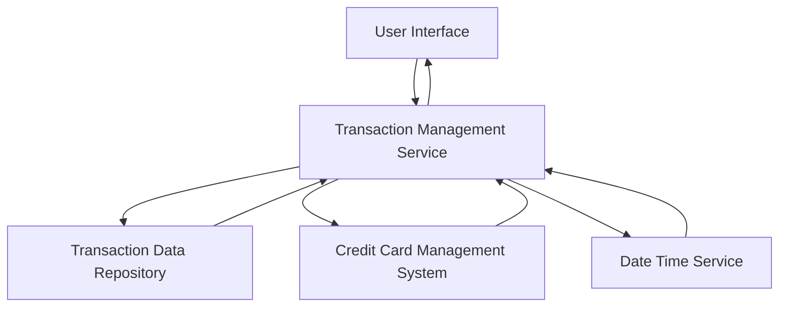

#### 1. High-Level Design

- **Summary:** This epic enables users to view and track all credit card transactions across multiple cards. Users can access detailed transaction history, view transaction details, and monitor spending activity to verify charges and identify spending patterns over time.

- **Component Flow:**

- **Integration Points:**
  - **Upstream:** Transaction data service/repository for retrieving transaction records
  - **Upstream:** Credit card management system for linking transactions to specific cards
  - **Upstream:** Date/time service for transaction timestamps and sorting
  - **Downstream:** Transaction listing UI for displaying transaction history and details

- **Key Assumptions:**
  - Transactions are stored with standard attributes (transaction_id, card_id, amount, merchant, timestamp, category)
  - Transaction retrieval supports pagination or lazy loading to handle up to 1000 transactions per card efficiently

- **NFR Highlights:** System must handle and display up to 1000 transactions per card efficiently; transaction list should load within 3 seconds; responsive and accessible across all device types

#### 2. Validation Report

- **Requirements Coverage:** The design addresses all scope elements including transaction listing, transaction details view, multi-card transaction aggregation, transaction history access, and transaction data display. The architecture incorporates the transaction data repository, credit card management system, and date/time service as specified in dependencies. The component flow supports efficient data retrieval and presentation. NFRs for handling 1000 transactions per card, 3-second load time, and responsive interface are supported by the service-oriented architecture with repository pattern for optimized data access.