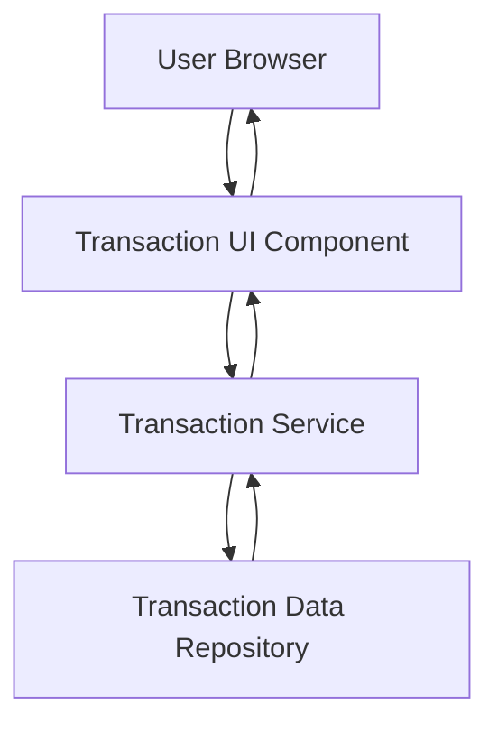

### 1. High-Level Design

**Summary:**  
This epic provides comprehensive transaction management functionality, enabling users to view transaction history, details, and metadata across all their credit cards. The system offers a unified interface for tracking purchases and financial activities, supporting multiple cards with responsive design.

**Component Flow:**

**Integration Points:**
- **Upstream:** Transaction data service or repository for retrieving historical and current transaction information
- **Downstream:** Transaction UI displays transaction lists and detail views to the user

**Key Assumptions:**
- Transactions are stored with standardized metadata (date, amount, merchant, card ID); API supports filtering and pagination for efficient retrieval.
- Transaction data is read-only in this epic; no transaction editing or dispute management is included.

**NFR Highlights:**  
System must efficiently handle and display transaction data for users with multiple credit cards; transaction views must be responsive across all device types.

### 2. Validation Report

**Requirements Coverage:**  
The design addresses all scope items: transaction listing, transaction details view, multi-card transaction support, transaction history access, and responsive transaction interface. Integration with the transaction data service ensures comprehensive data retrieval. The architecture supports the NFRs for efficient data handling and responsive design across devices.