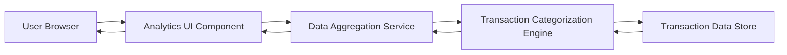

### 1. High-Level Design

**Summary:**  
This epic delivers interactive analytics and visualization capabilities that provide deep insights into user spending patterns. Users can analyze monthly spend trends, category-wise spending distributions (across 9 predefined categories), and card-wise spend analysis through intuitive, interactive charts and graphs.

**Component Flow:**

**Integration Points:**
- **Upstream:** Transaction categorization service/engine to classify transactions into spending categories (Food & Dining, Fuel, Shopping, Travel, Entertainment, Utilities, Healthcare, Education, Miscellaneous)
- **Upstream:** Data aggregation service for computing trends, monthly spend totals, and card-wise analytics
- **Upstream:** Transaction data store as the source of raw transaction data

**Key Assumptions:**
- Transactions are auto-categorized by the categorization engine using merchant codes or machine learning; users may have limited ability to recategorize.
- Analytics are computed in near-real-time or with acceptable latency (e.g., nightly batch processing for trends, on-demand for interactive queries).

**NFR Highlights:**  
Analytics visualizations must be interactive and responsive; system must support real-time or near-real-time data aggregation for accurate spending insights.

### 2. Validation Report

**Requirements Coverage:**  
The design covers all scope elements: monthly spend trend visualization, category-wise spending analysis, interactive charts and graphs, card-wise spend analysis, spending pattern identification, and multi-category support for all 9 specified categories. Dependencies on transaction categorization and data aggregation services are addressed. The architecture supports the NFRs for interactive, responsive visualizations and real-time/near-real-time data aggregation.