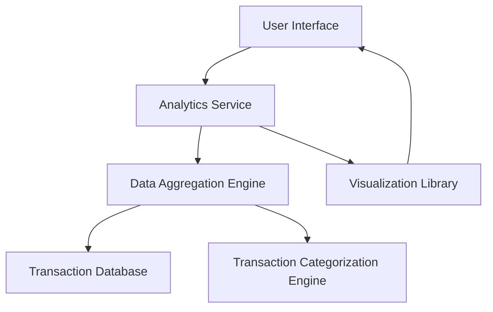

#### 1. High-Level Design

- **Summary:** This epic delivers interactive visualizations and analytical capabilities to help users understand spending patterns across nine predefined categories (Food & Dining, Fuel, Shopping, Travel, Entertainment, Utilities, Healthcare, Education, Miscellaneous). Users can analyze monthly spend trends, identify spending habits, and make data-driven financial decisions. Visualizations render within 3 seconds and support historical data analysis.

- **Component Flow:**

- **Integration Points:**
  - **Upstream:** Transaction Categorization Engine (for pre-categorized transaction data or on-demand categorization)
  - **Downstream:** Transaction Database (for historical spending data and transaction records)
  - **External:** Charting/Visualization Library (for rendering interactive charts and graphs)

- **Key Assumptions:** 
  - Transactions are pre-categorized into the nine defined categories; no automated categorization of uncategorized transactions is performed.
  - Historical transaction data is retained for at least 12 months to support meaningful trend analysis.

- **NFR Highlights:** Visualizations must render within 3 seconds; charts must be interactive and responsive; system must handle historical data for trend analysis; support for data aggregation and filtering; accurate calculation of category totals.

- **Data Flow:** User requests spending insights → Analytics Service receives request with filter parameters (date range, categories) → Data Aggregation Engine queries Transaction Database for historical transactions → Categorization Engine validates/enriches category data → Aggregated spending data by category and time period is computed → Analytics Service formats data for visualization → Visualization Library renders interactive charts showing category-wise spending and monthly trends → User interacts with responsive, filterable visualizations.

#### 2. Validation Report

- **Requirements Coverage:** The design fully addresses the epic's scope including category-wise spending visualization, monthly spend trend charts, interactive analytics dashboard, spending pattern identification, and multi-category analysis across all nine specified categories (Food & Dining, Fuel, Shopping, Travel, Entertainment, Utilities, Healthcare, Education, Miscellaneous). The architecture supports the 3-second rendering requirement through optimized data aggregation and leverages a dedicated Visualization Library for interactive, responsive charts. All dependencies (transaction categorization engine, transaction database, and charting library) are integrated. The design supports historical data handling, data aggregation, filtering, and accurate category total calculations as specified in the NFRs.