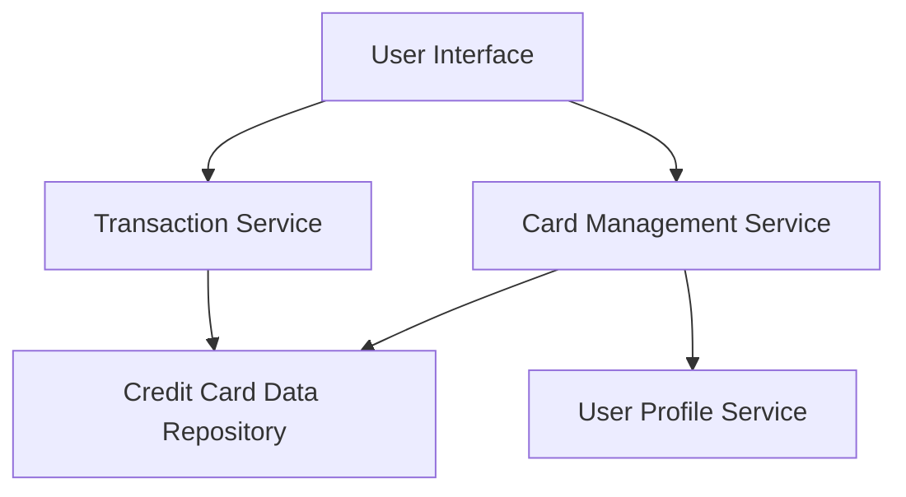

#### 1. High-Level Design

- **Summary:** This epic enables users to manage and monitor multiple credit cards (up to 10 per user) from a unified interface. Users can view all cards, access card-specific details (credit limits, balances), and track transactions across all cards. The solution provides comprehensive visibility into each card's activity and spending patterns on a per-card basis.

- **Component Flow:**

- **Integration Points:**
  - **Upstream:** User Profile Service (to associate cards with specific users and authenticate access)
  - **Downstream:** Credit Card Data Repository (for card information, balances, limits, and transaction records)

- **Key Assumptions:** 
  - Transaction data is pre-loaded and available in the Credit Card Data Repository with accurate timestamps.
  - Card ownership is already established in the User Profile Service; no card provisioning or onboarding flow is included.

- **NFR Highlights:** System must support at least 10 credit cards per user; maintain performance with large transaction volumes; ensure data accuracy and consistency across all card views.

- **Data Flow:** User requests card portfolio view → Card Management Service retrieves card details from Credit Card Data Repository and validates user ownership via User Profile Service → Transaction Service fetches transaction history for each card → Aggregated card and transaction data is returned to UI for display, enabling card-specific spend analysis and balance tracking.

#### 2. Validation Report

- **Requirements Coverage:** The design fully covers the epic's stated scope including multiple credit card display, card-wise spend analysis, transaction listing, card details view, card-specific balance tracking, and transaction history access. The architecture supports the NFR of managing at least 10 cards per user and maintains data accuracy through dedicated services. All identified dependencies (Credit Card Data Repository and User Profile Service) are incorporated into the component flow.