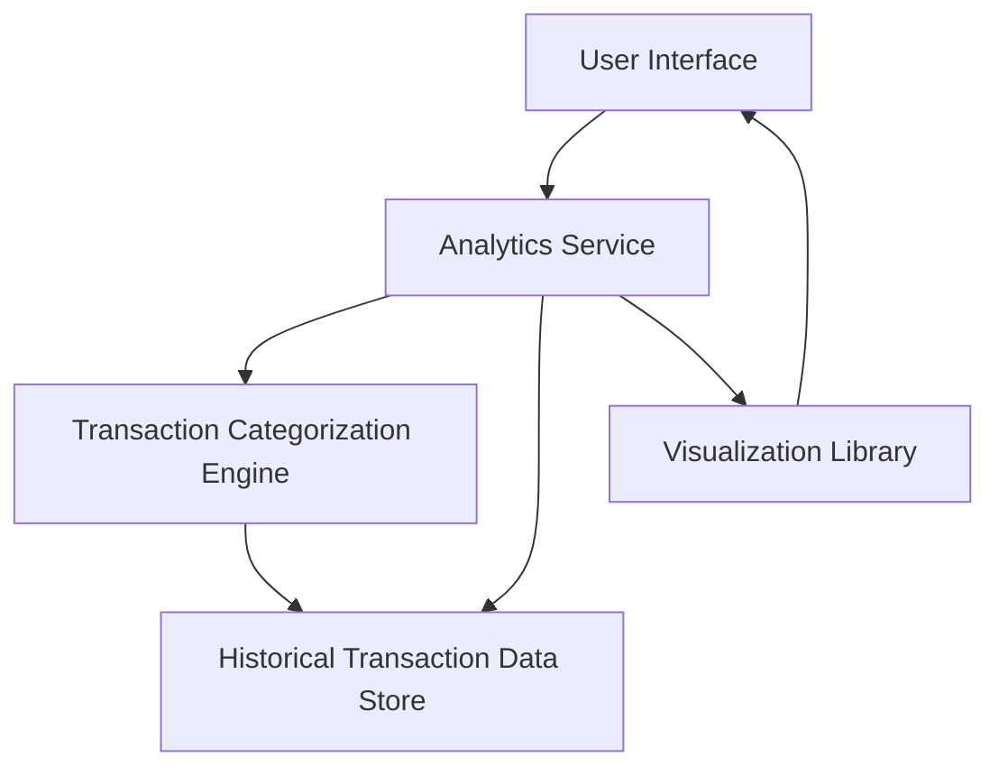

#### 1. High-Level Design

- **Summary:** This epic provides comprehensive analytics and visualization capabilities to help users understand spending patterns and trends. Users access interactive visualizations showing category-wise spending across 9 predefined categories (Food & Dining, Fuel, Shopping, Travel, Entertainment, Utilities, Healthcare, Education, Miscellaneous) and Monthly Spend Trends analysis based on minimum 12 months of historical data.

- **Component Flow:**

- **Integration Points:** 
  - **Upstream:** Transaction Categorization Engine (for category assignment logic)
  - **Downstream:** Historical Transaction Data Store (for transaction history), Visualization Library (for chart rendering)

- **Key Assumptions:** 
  - Transactions are pre-categorized by the Transaction Categorization Engine into the 9 defined categories.
  - Historical Transaction Data Store retains at least 12 months of transaction data with timestamps and category tags.

- **NFR Highlights:** Analytics processing must complete within 3 seconds, support interactive visualizations with smooth rendering, handle historical data for minimum 12 months, chart rendering optimized for various screen sizes.

- **Data Flow:** User requests analytics view → Analytics Service queries Historical Transaction Data Store for user's transactions (12+ months) → Transaction Categorization Engine provides category mappings → Service aggregates spending by category and by month → Aggregated data passed to Visualization Library → Interactive charts/graphs rendered in UI within 3 seconds → User interacts with visualizations (filtering, drill-down) with smooth rendering performance → Time-based trend analysis computed on-demand for selected periods.

#### 2. Validation Report

- **Requirements Coverage:** The design fully addresses the epic's scope: category-wise spending visualization, monthly spend trends analysis, interactive charts and graphs, spending pattern identification, category breakdown for all 9 specified categories, and time-based trend analysis. All NFRs are covered: 3-second analytics processing via optimized aggregation, interactive visualizations through Visualization Library integration, 12+ months historical data support, and responsive chart rendering. Integration dependencies with Transaction Categorization Engine, Historical Transaction Data Store, Visualization Library, and Analytics computation service are explicitly mapped.