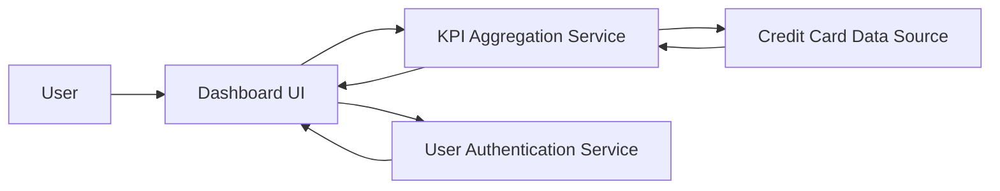

#### 1. High-Level Design

- **Summary:** This epic delivers a centralized dashboard displaying key performance indicators (KPIs) for credit card management. Users view critical financial metrics: Monthly Spend, Total Credit Limit, Available Credit, and Outstanding Amount in a consolidated interface. The dashboard serves as the primary landing page providing real-time visibility into overall credit card financial health across all cards.

- **Component Flow:**

- **Integration Points:** 
  - **Upstream:** User Authentication Service (for personalized dashboard access)
  - **Downstream:** Credit Card Data Source (for real-time KPI data)

- **Key Assumptions:** 
  - Credit Card Data Source provides real-time or near-real-time data via API with aggregation capabilities.
  - KPI calculations (Total Credit Limit, Available Credit, Outstanding Amount) follow standard financial formulas.

- **NFR Highlights:** Dashboard must load within 2 seconds, support responsive design for mobile and desktop devices, real-time data refresh capability, support concurrent viewing by multiple users.

- **Data Flow:** User accesses dashboard → Authentication Service validates user identity → Dashboard UI requests KPI data from KPI Aggregation Service → Service queries Credit Card Data Source for all user's cards → Service computes Monthly Spend, Total Credit Limit, Available Credit, Outstanding Amount → Aggregated metrics returned to Dashboard UI within 2-second load time → UI renders responsive layout with KPI visualizations → Real-time refresh updates data without full page reload.

#### 2. Validation Report

- **Requirements Coverage:** The design comprehensively covers all stated scope elements: Monthly Spend display, Total Credit Limit calculation, Available Credit tracking, Outstanding Amount monitoring, responsive dashboard layout, and KPI visualization components. All NFRs are addressed: 2-second load time through optimized aggregation service, responsive design via UI layer, real-time refresh capability, and concurrent user support. Integration dependencies with Credit Card Data Source and User Authentication Service are clearly defined.