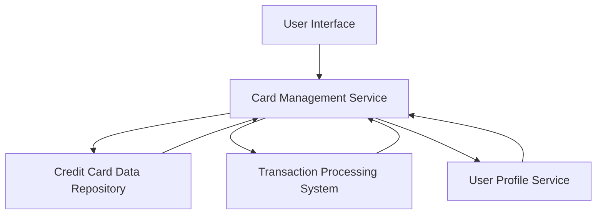

#### 1. High-Level Design

- **Summary:** This epic enables users to manage and monitor multiple credit cards (minimum 10 per user) within a single unified interface. Users can view all cards, access card-specific details, perform card-wise spend analysis, and view individual transaction histories. The system provides both aggregated and individual card metrics.

- **Component Flow:**

- **Integration Points:** 
  - **Upstream:** User Profile Service (for card ownership validation)
  - **Downstream:** Credit Card Data Repository, Transaction Processing System

- **Key Assumptions:** 
  - Card data is pre-loaded and available in the Credit Card Data Repository with standardized schema.
  - Transaction history is accessible via API with filtering capabilities by card ID.

- **NFR Highlights:** System must support minimum 10 credit cards per user, card switching response time under 500ms, secure card information storage and display, data consistency across card views.

- **Data Flow:** User authenticates and requests card portfolio view → Card Management Service validates user ownership via User Profile Service → Service retrieves card metadata from Credit Card Data Repository → For selected card, service fetches transaction history from Transaction Processing System → Aggregated and card-specific metrics are computed and returned to UI → User can switch between cards with sub-500ms response time.

#### 2. Validation Report

- **Requirements Coverage:** The design fully covers the epic's stated scope including multiple credit card display, card-wise spend analysis, individual card details view, card selection and filtering, card-specific transaction history, and card metadata management. All NFRs (10+ cards support, <500ms switching, data consistency, security) are addressed through the architecture. Integration dependencies with Credit Card Data Repository, Transaction Processing System, and User Profile Service are explicitly mapped.