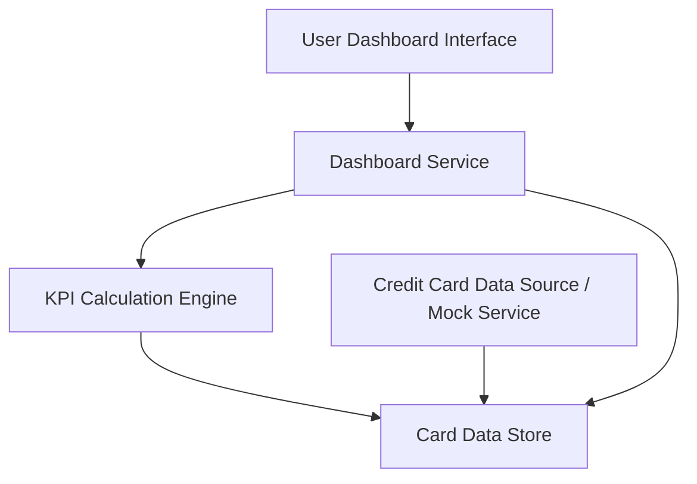

#### 1. High-Level Design

- **Summary:** This epic enables users to view and manage multiple credit cards (up to 20) from a consolidated dashboard interface. Users can monitor key performance indicators including monthly spend, total credit limit, available credit, and outstanding amounts. The dashboard provides a comprehensive overview for tracking credit utilization and financial health, supporting informed credit card management decisions.

- **Component Flow:**

- **Integration Points:**
  - **Upstream:** Credit card data source or mock data service for card details (card number, issuer, type, limits) and balance information
  - **Internal:** May consume aggregated transaction data from Transaction Management system (QE-7583) for monthly spend calculation

- **Key Assumptions:**
  - Card data is provided via mock service with fields for credit limit, current balance, and outstanding amount; Monthly spend is calculated from transaction data or provided as a pre-aggregated field.

- **NFR Highlights:** System must support responsive layouts across desktop, tablet, and mobile devices; Dashboard load time must be under 2 seconds; Support concurrent viewing of up to 20 credit cards per user.

- **Data Flow:** User accesses dashboard → Dashboard Service retrieves card data from Card Data Store (populated by Credit Card Data Source/Mock Service) → KPI Calculation Engine computes aggregated metrics (total credit limit, available credit, outstanding amounts, monthly spend across all cards) → Dashboard Service formats KPI data → User views consolidated dashboard with all cards and KPIs on responsive interface (desktop/tablet/mobile).

#### 2. Validation Report

- **Requirements Coverage:** The design fully addresses the epic's scope including dashboard KPIs display (monthly spend, total credit limit, available credit, outstanding amount), multiple credit card view (up to 20 cards), tracking capabilities, and responsive dashboard layout. All NFRs are covered: responsive layouts across devices (handled by User Dashboard Interface), dashboard load time under 2 seconds (optimized by Dashboard Service and KPI Calculation Engine), and support for up to 20 cards per user (addressed in architecture design). Dependencies on credit card data source/mock service are explicitly integrated into the component flow.